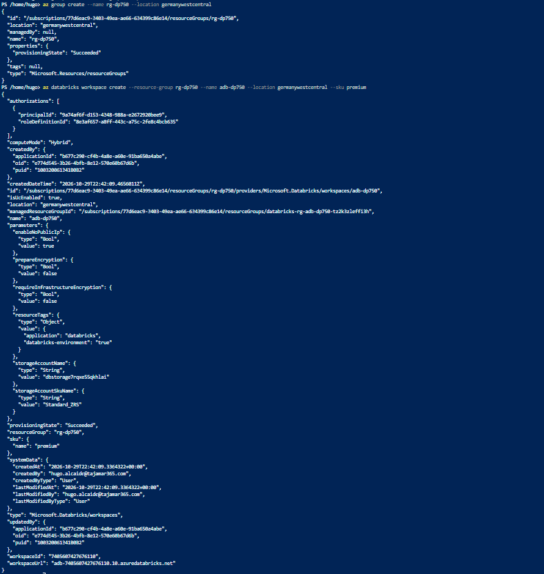
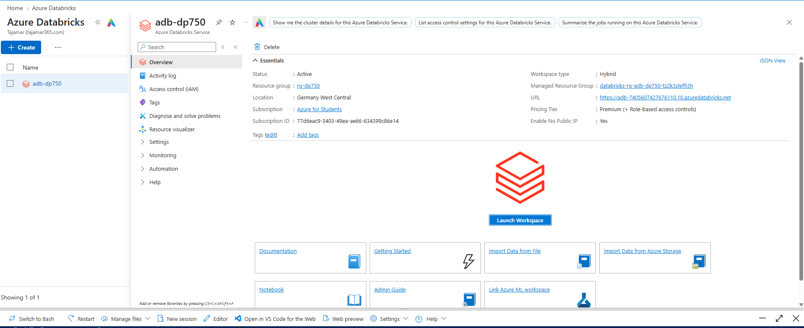
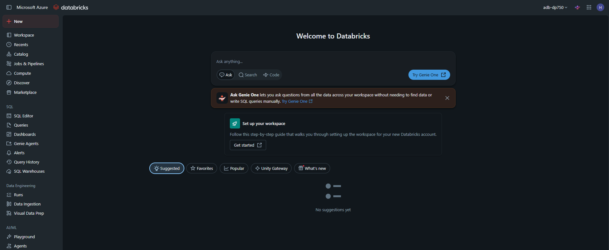

# Laboratorio 00: Set Up Your Azure Databricks Environment

En este laboratorio se realiza el aprovisionamiento automatizado de la infraestructura base para las cargas de trabajo de ingeniería de datos en **Azure Databricks**, preparando el entorno para la integración con **Unity Catalog** y arquitecturas de datos empresariales:
1. **Aprovisionamiento Automatizado (Cloud Shell):** Descarga y ejecución del script de despliegue mediante **Azure CLI** sobre **Azure Cloud Shell (Bash)**, aprovisionando el grupo de recursos `rg-dp750` y el workspace `adb-dp750` en nivel **Premium** (`--sku premium`).
2. **Auditoría de Recursos en Azure Portal:** Verificación del estado de despliegue (`provisioningState: Succeeded`), validación de los metadatos de red, grupo de recursos administrado y controles de acceso basados en roles (RBAC).
3. **Inicialización y Conectividad del Workspace:** Acceso federado al workspace de Azure Databricks vía Single Sign-On (SSO) con Microsoft Entra ID (*Launch Workspace*), comprobando la disponibilidad de la interfaz principal para catálogos y cómputo.

---

## Paso 1: Aprovisionamiento Automatizado mediante Azure CLI en Cloud Shell

Se abre la consola interactiva de **Azure Cloud Shell** en modo Bash y se lanza el script oficial de configuración que invoca los comandos de la CLI de Azure para crear el grupo de recursos y desplegar el servicio de Databricks en SKU Premium:

```bash
# Descarga y ejecución del script oficial de aprovisionamiento
curl -sL [https://raw.githubusercontent.com/MicrosoftLearning/DP-750T00-Implement-Data-Engineering-Solutions-using-Azure-Databricks/refs/heads/main/Instructions/Labs/00-setup.sh](https://raw.githubusercontent.com/MicrosoftLearning/DP-750T00-Implement-Data-Engineering-Solutions-using-Azure-Databricks/refs/heads/main/Instructions/Labs/00-setup.sh) | bash
```

Comandos nativos ejecutados internamente por la automatización:

```bash
# 1. Creación del grupo de recursos
az group create \
  --name rg-dp750 \
  --location germanywestcentral

# 2. Despliegue del workspace en tier Premium (necesario para Unity Catalog)
az databricks workspace create \
  --resource-group rg-dp750 \
  --name adb-dp750 \
  --location germanywestcentral \
  --sku premium
```

Se comprueba la respuesta en formato JSON devuelta por el Resource Manager, confirmando el estado `provisioningState: "Succeeded"` y el `workspaceUrl` asignado:



---

## Paso 2: Verificación del Workspace en Azure Portal

En el portal de Azure, se accede a la hoja de recursos de **Azure Databricks** y se selecciona el workspace `adb-dp750` para validar sus parámetros operativos:

* **Resource Group:** `rg-dp750`.
* **Location:** `Germany West Central`.
* **Pricing Tier:** `Premium (+ Role-based access controls)`.
* **Managed Resource Group:** `databricks-rg-adb-dp750-tz2k3zleffi3h`.
* **Status:** `Active`.



---

## Paso 3: Inicialización y Comprobación del Workspace de Databricks

Desde la vista general del recurso en Azure Portal, se hace clic en **Launch Workspace**. La sesión se autentica federada mediante SSO y se accede al entorno de trabajo principal de Azure Databricks, confirmando la visibilidad de los paneles de navegación para **Workspace**, **Catalog**, **Compute** y **SQL Warehouses**:

