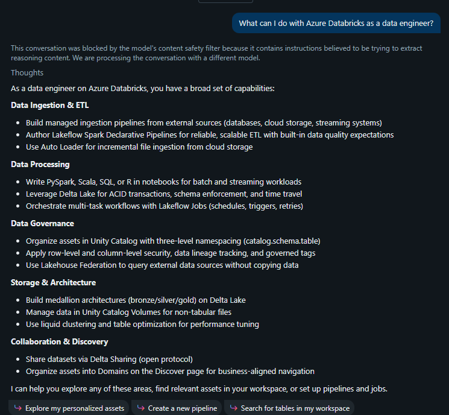
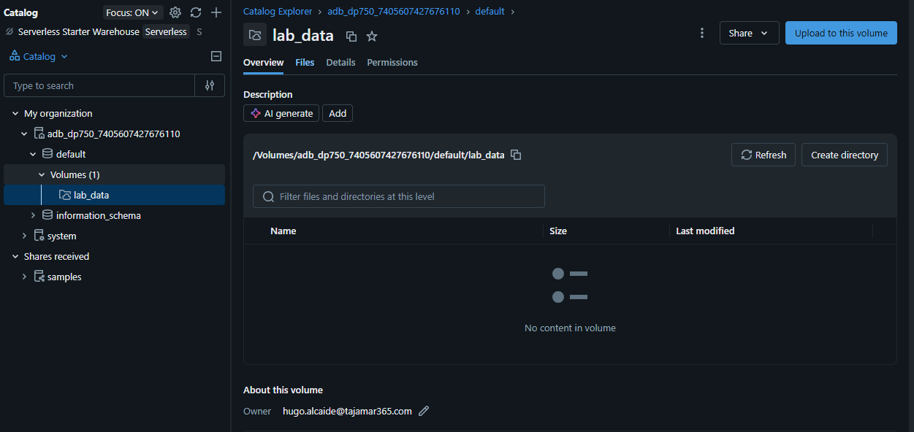
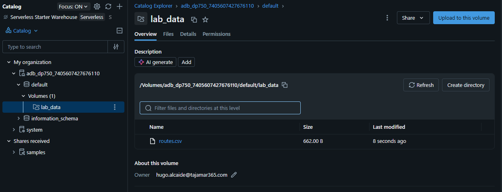
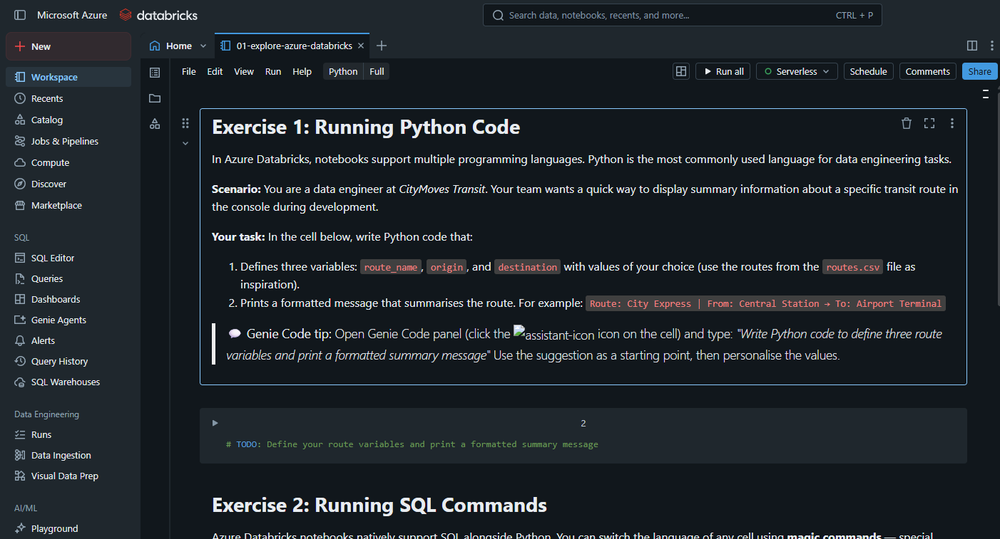
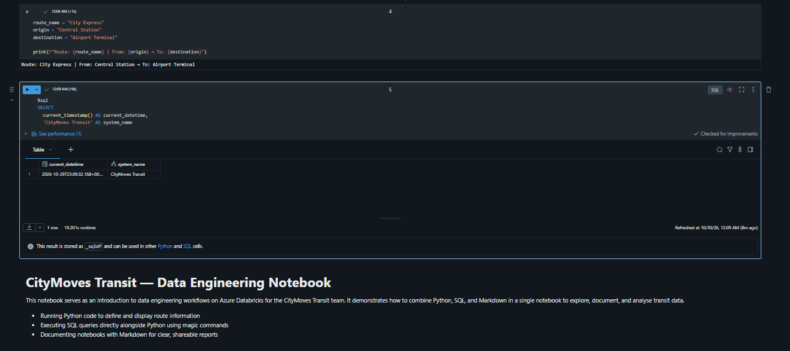

# Laboratorio 01: Explore Azure Databricks

En este laboratorio se realiza la toma de contacto y configuración del entorno de trabajo en **Azure Databricks** bajo el escenario de **CityMoves Transit**, la autoridad de transporte público metropolitano:
1. **Exploración de la Interfaz y Asistencia con IA:** Navegación por las secciones clave del workspace (Workspace, Catalog, Compute, Jobs & Pipelines) e interacción contextual con el asistente de código integrado **Genie Code**.
2. **Almacenamiento Desestructurado en Unity Catalog (Volumes):** Creación de un volumen gestionado (`lab_data`) dentro del esquema `default` para el almacenamiento y gobierno de ficheros sin estructura tabular.
3. **Ingesta de Datos:** Carga del archivo de rutas de transporte `routes.csv` en la ruta `/Volumes/...` de Unity Catalog mediante la interfaz de ingesta.
4. **Entorno Políglota de Notebooks con Cómputo Serverless:** Importación del notebook de trabajo, conexión a infraestructura **Serverless compute** y ejecución combinada de celdas en **Python**, comandos mágicos de **Spark SQL** (`%sql`) y documentación enriquecida en **Markdown**.

---

## Paso 1: Exploración de la Interfaz y Consulta a Genie Code

Se examina la barra de navegación lateral izquierda del workspace de Azure Databricks y se abre el panel interactivo de **Genie Code** para evaluar las capacidades de asistencia de IA en tareas de ingeniería de datos con la consulta:

```text
What can I do with Azure Databricks as a data engineer?
```

Genie Code desglosa las capacidades clave organizadas por dominios: Ingestión & ETL (Lakeflow Spark Declarative Pipelines, Auto Loader), Procesamiento (Delta Lake, PySpark/SQL), Gobierno de Datos (Unity Catalog, seguridad de fila/columna y linaje), Almacenamiento & Arquitectura (Lakehouse Medallion) y Compartición (Delta Sharing):



---

## Paso 2: Creación del Volumen Gestionado en Unity Catalog

En el explorador de datos (**Catalog Explorer**), se navega a través de la jerarquía de tres niveles de Unity Catalog (`adb_dp750_<workspace_id>` $\rightarrow$ `default`). Se crea un nuevo volumen de tipo administrado denominado `lab_data`, habilitando el punto de montaje `/Volumes/adb_dp750_7405607427676110/default/lab_data`:



---

## Paso 3: Ingesta del Dataset routes.csv en el Volumen

Desde la opción **+ New** $\rightarrow$ **Add or upload data**, se descarga el dataset de muestra `routes.csv` de CityMoves Transit y se sube como destino al volumen gestionado `lab_data`. Se valida en Catalog Explorer la presencia del fichero con un tamaño de 662.00 B:



---

## Paso 4: Importación del Notebook y Conexión a Serverless Compute

En la sección **Workspace**, se importa el notebook interactivo del laboratorio desde la URL oficial del repositorio:

```text
[https://raw.githubusercontent.com/MicrosoftLearning/DP-750T00-Implement-Data-Engineering-Solutions-using-Azure-Databricks/refs/heads/main/Allfiles/01-explore-azure-databricks.ipynb](https://raw.githubusercontent.com/MicrosoftLearning/DP-750T00-Implement-Data-Engineering-Solutions-using-Azure-Databricks/refs/heads/main/Allfiles/01-explore-azure-databricks.ipynb)
```

En el selector superior de recursos de computación se vincula al entorno **Serverless compute**, permitiendo inicialización inmediata sin necesidad de aprovisionar un clúster dedicado:



---

## Paso 5: Ejecución Políglota en el Notebook (Python, SQL y Markdown)

Se ejecutan de manera secuencial los ejercicios del notebook, demostrando la interoperabilidad de lenguajes y la renderización en el mismo entorno interactivo:

### 5.1 Ejercicio 1: Ejecución de código Python
Se declaran las variables de ruta y se formatea el mensaje de resumen:

```python
route_name = "City Express"
origin = "Central Station"
destination = "Airport Terminal"

print(f"Route: {route_name} | From: {origin} -> To: {destination}")
```

Salida por consola:
```text
Route: City Express | From: Central Station -> To: Airport Terminal
```

### 5.2 Ejercicio 2: Ejecución de comandos SQL con Magic Commands
Se utiliza el prefijo `%sql` para alternar el motor de ejecución a Spark SQL sobre el mismo notebook, obteniendo la marca temporal y el identificador del sistema:

```sql
%sql
SELECT
    current_timestamp() AS current_datetime,
    'CityMoves Transit' AS system_name
```

### 5.3 Ejercicio 3: Renderizado de documentación Markdown
Se valida la visualización del bloque descriptivo para CityMoves Transit con formato estructurado de títulos, listas y texto explicativo:

