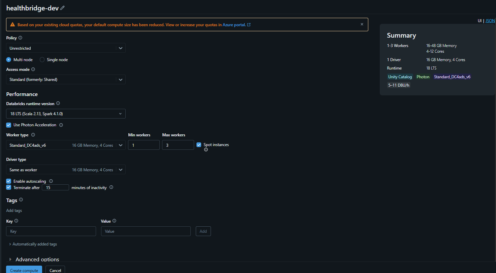
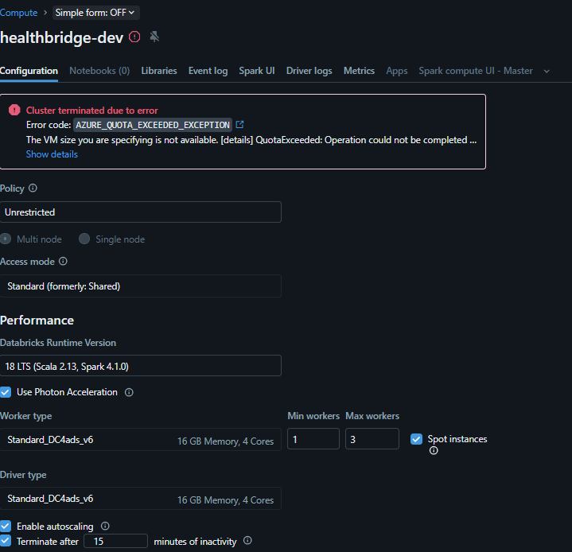

# Lab 02: Select and Configure Compute in Azure Databricks

## 1. Configuración del Clúster
Siguiendo las instrucciones del laboratorio, se procedió a configurar el clúster interactivo con los siguientes parámetros solicitados:

- **Cluster Name:** `healthbridge-dev`
- **Policy:** `Unrestricted`
- **Cluster Mode:** `Multi node`
- **Access Mode:** `Standard (formerly: Shared)`
- **Databricks Runtime:** 18 LTS con `Photon Acceleration` activado
- **Worker / Driver Type:** `Standard_DC4ads_v6`
- **Autoscaling:** Mínimo 1 worker, máximo 3 workers
- **Auto Termination:** 15 minutos de inactividad

---

## 2. Bloqueo por Límite de Cuota en la Suscripción
Al intentar aprovisionar e iniciar el clúster, el proceso falló y la creación se canceló automáticamente debido a una restricción en la suscripción de Azure:

- **Error Code:** `AZURE_QUOTA_EXCEEDED_EXCEPTION`
- **Detalle:** `The VM size you are specifying is not available. [details] QuotaExceeded: Operation could not be completed...`

> **Nota:** La suscripción actual no dispone del límite de vCPUs suficiente para aprovisionar las instancias requeridas para este clúster multi-nodo. El laboratorio queda documentado hasta este punto debido a la imposibilidad de arrancar el cómputo por restricciones de infraestructura de la cuenta.