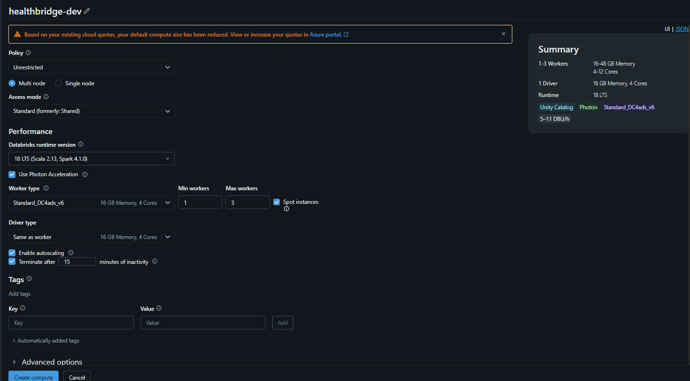
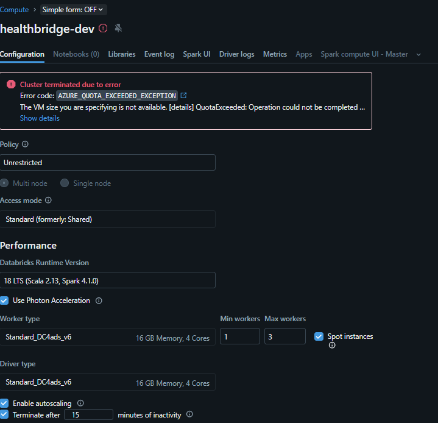

# Laboratorio 02: Select and Configure Compute in Azure Databricks

En este laboratorio se aborda la selección, dimensionamiento y configuración de infraestructura de computación en **Azure Databricks** para las cargas de trabajo de **HealthBridge Analytics** (análisis y validación de registros clínicos, admisiones hospitalarias y facturación):
1. **Configuración de Cómputo All-Purpose:** Definición de un clúster interactivo multi-nodo (`healthbridge-dev`) con aceleración por hardware **Photon**, políticas de escalado dinámico (*Autoscaling*) y mecanismos de control presupuestario mediante temporizador de inactividad (*Auto-termination*).
2. **Evaluación de Restricciones Cloud (Azure ARM Quotas):** Diagnóstico y documentación de la excepción de capacidad por límites de cuota de vCPU (`AZURE_QUOTA_EXCEEDED_EXCEPTION`) al solicitar instancias optimizadas en memoria dentro de la región del laboratorio.

---

## Paso 1: Configuración del Clúster All-Purpose healthbridge-dev

En el panel lateral de **Compute**, se selecciona **Create compute** y se desactiva el asistente básico (*Simple form: OFF*) para parametrizar el clúster según las especificaciones técnicas del entorno de desarrollo:

* **Cluster Name:** `healthbridge-dev`
* **Policy:** `Unrestricted`
* **Cluster Mode:** `Multi node`
* **Access Mode:** `Standard (formerly: Shared)`
* **Databricks Runtime Version:** `18 LTS (Scala 2.13, Spark 4.1.0)`
* **Photon Acceleration:** Habilitado (`Use Photon Acceleration`) para acelerar la ejecución vectorial y transformaciones SQL.
* **Worker & Driver Type:** `Standard_DC4ads_v6` (16 GB de RAM, 4 vCPUs).
* **Autoscaling:** Activado con un rango de `1` (mínimo) a `3` (máximo) workers.
* **Auto Termination:** Configurado a `15` minutos de inactividad para evitar costes imprevistos de computación desatendida.
* **Spot Instances:** Activadas para optimizar el consumo de créditos en pruebas de desarrollo.



---

## Paso 2: Bloqueo por Límite de Cuota en la Suscripción (AZURE_QUOTA_EXCEEDED_EXCEPTION)

Durante la fase de aprovisionamiento de las máquinas virtuales en Azure Resource Manager (ARM), el despliegue es cancelado automáticamente por el proveedor cloud debido a una restricción de cuota de hardware en la suscripción:



```text
Cluster terminated due to error
Error code: AZURE_QUOTA_EXCEEDED_EXCEPTION
The VM size you are specifying is not available. [details] QuotaExceeded: Operation could not be completed...