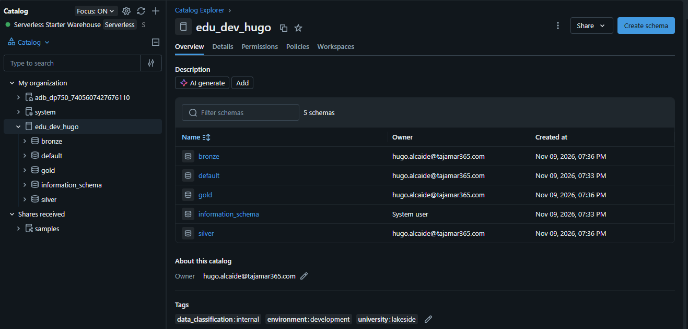
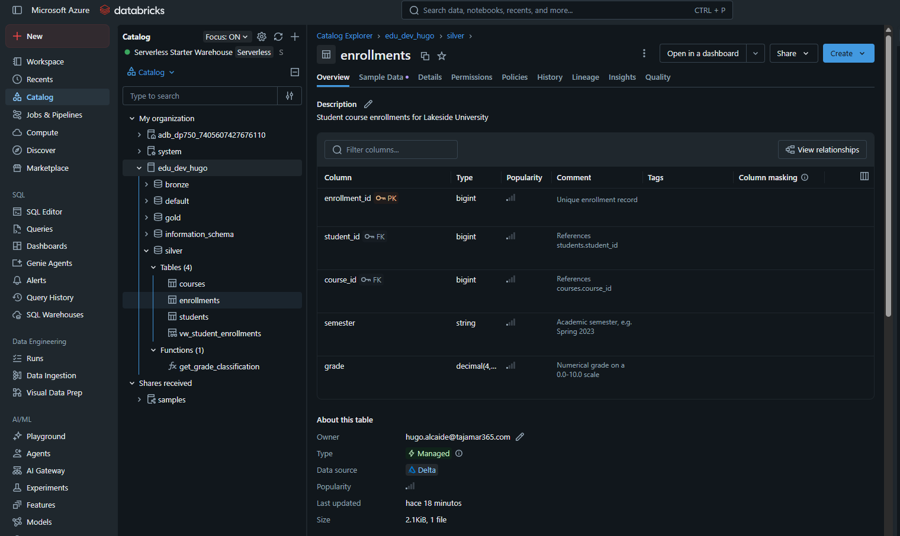
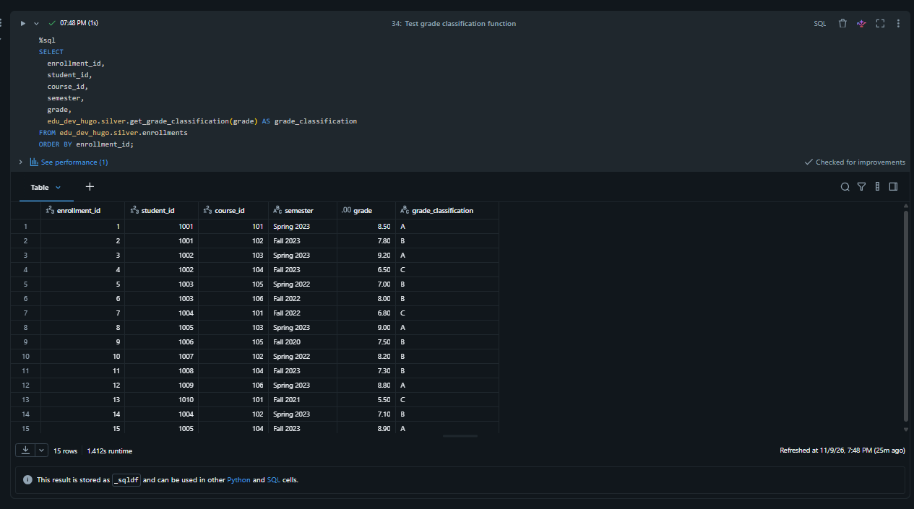
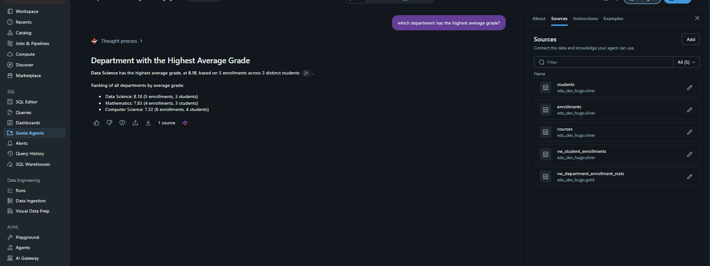

# Laboratorio 03: Create and Organize Objects in Unity Catalog

En este laboratorio se diseña e implementa la infraestructura de datos para **Lakeside University** en **Azure Databricks**, aplicando el espacio de nombres de tres niveles (*Catalog.Schema.Object*) y gobernanza centralizada mediante **Unity Catalog**:

1. **Catálogo y Esquemas Medallion:** Configuración de almacenamiento gestionado dedicado (`edu_dev_hugo`), despliegue de capas Medallion (`bronze`, `silver`, `gold`) y asignación de etiquetas de gobernanza.
2. **Modelado Relacional con Restricciones:** Definición de tablas gestionadas Delta en la capa Silver con restricciones de clave primaria (`PK`) y clave foránea (`FK`) informacionales (`RELY`).
3. **Capa de Consumo Analítico:** Creación de vistas estándar consolidadas y vistas materializadas precomputadas bajo computación Serverless.
4. **Almacenamiento No Estructurado y Lógica SQL:** Despliegue de un volumen gestionado, evolución de esquema y desarrollo de una función escalar para clasificación de calificaciones.
5. **AI/BI Genie Agent:** Configuración semántica y validación de consultas analíticas en lenguaje natural.

---

## 1. Catálogo, Esquemas Medallion y Gobernanza de Metadatos

Debido a que el metastore del entorno de formación carece de una raíz de almacenamiento global predeterminada (`NO_DEFAULT_STORAGE_LOCATION`), se aprovisionó el catálogo dedicado **`edu_dev_hugo`** vinculándolo directamente a la ubicación externa de almacenamiento del workspace (`abfss://unity-catalog-storage@.../7405607427676110/edu_dev_hugo`).

Dentro del catálogo se estructuraron los esquemas de la arquitectura Medallion y se aplicaron etiquetas para control normativo:

* **Esquemas:**
  * `bronze`: Ingesta inicial de datos en crudo sin transformar.
  * `silver`: Limpieza, estructuración relacional y reglas de negocio.
  * `gold`: Agregaciones analíticas listas para consumo y BI.
* **Tags aplicados:** `environment: development`, `university: lakeside`, `data_classification: internal`.

```sql
USE CATALOG edu_dev_hugo;

CREATE SCHEMA IF NOT EXISTS bronze COMMENT 'Raw ingested data - unmodified source files';
CREATE SCHEMA IF NOT EXISTS silver COMMENT 'Cleaned, validated, and enriched data';
CREATE SCHEMA IF NOT EXISTS gold COMMENT 'Aggregated, analytics-ready data';

ALTER CATALOG edu_dev_hugo SET TAGS (
    'environment' = 'development',
    'university' = 'lakeside',
    'data_classification' = 'internal'
);
```



---

## 2. Creación de Tablas con Restricciones en Capa Silver

Se modelaron las entidades operativas del sistema académico. En Unity Catalog, las restricciones `PRIMARY KEY` y `FOREIGN KEY` con el modificador `RELY` son declarativas: informan al optimizador Catalyst para mejorar los planes de ejecución de las consultas sin penalizar la velocidad de escritura:

```sql
-- Directorio de Estudiantes
CREATE TABLE IF NOT EXISTS edu_dev_hugo.silver.students (
    student_id BIGINT NOT NULL,
    first_name STRING,
    last_name STRING,
    email STRING,
    enrolled_date DATE,
    CONSTRAINT students_pk PRIMARY KEY (student_id) RELY
) COMMENT 'Cleaned student profiles';

-- Directorio de Cursos
CREATE TABLE IF NOT EXISTS edu_dev_hugo.silver.courses (
    course_id BIGINT NOT NULL,
    course_code STRING,
    course_name STRING,
    department STRING,
    credits INT,
    CONSTRAINT courses_pk PRIMARY KEY (course_id) RELY
) COMMENT 'Curriculum course directory';

-- Registro de Matrículas y Calificaciones
CREATE TABLE IF NOT EXISTS edu_dev_hugo.silver.enrollments (
    enrollment_id BIGINT NOT NULL,
    student_id BIGINT,
    course_id BIGINT,
    semester STRING,
    grade DECIMAL(4,2),
    CONSTRAINT enrollments_pk PRIMARY KEY (enrollment_id) RELY,
    CONSTRAINT enrollments_students_fk FOREIGN KEY (student_id) REFERENCES edu_dev_hugo.silver.students (student_id) RELY,
    CONSTRAINT enrollments_courses_fk FOREIGN KEY (course_id) REFERENCES edu_dev_hugo.silver.courses (course_id) RELY
) COMMENT 'Student course registrations with grade records';
```



---

## 3. Capa Analítica: Vistas Estándar y Materializadas

Se configuraron dos niveles de acceso para las consultas departamentales:

### Vista Estándar (Silver)
Combina las tres entidades relacionales en un formato plano legible:
```sql
CREATE OR REPLACE VIEW edu_dev_hugo.silver.vw_student_enrollments AS
SELECT 
    CONCAT(s.first_name, ' ', s.last_name) AS full_name,
    s.email,
    c.course_name,
    c.department,
    e.semester,
    e.grade
FROM edu_dev_hugo.silver.enrollments e
JOIN edu_dev_hugo.silver.students s ON e.student_id = s.student_id
JOIN edu_dev_hugo.silver.courses c ON e.course_id = c.course_id;
```

### Vista Materializada (Gold)
Precalcula el volumen de matrículas, la nota promedio y los alumnos únicos por departamento académico, optimizando tiempos de respuesta sobre computación Serverless:
```sql
CREATE MATERIALIZED VIEW IF NOT EXISTS edu_dev_hugo.gold.vw_department_enrollment_stats AS
SELECT 
    c.department,
    COUNT(e.enrollment_id) AS total_enrollments,
    ROUND(AVG(e.grade), 2) AS average_grade,
    COUNT(DISTINCT e.student_id) AS unique_students
FROM edu_dev_hugo.silver.enrollments e
JOIN edu_dev_hugo.silver.courses c ON e.course_id = c.course_id
GROUP BY c.department;
```

---

## 4. Volúmenes Gestionados y Función Escalar SQL

### Volúmenes Gestionados (Managed Volumes)
Se aprovisionó el volumen `raw_files` en la capa Bronze para ingesta de archivos planos, cargando y consultando directamente `students.csv` mediante su ruta POSIX (`/Volumes/edu_dev_hugo/bronze/raw_files/students.csv`).

### Función Escalar de Negocio
Se implementó la función SQL `get_grade_classification` para asignar de manera determinista la equivalencia de calificación académica según la nota numérica ($0.0 - 10.0$):

```sql
CREATE OR REPLACE FUNCTION edu_dev_hugo.silver.get_grade_classification(grade DOUBLE)
RETURNS STRING
LANGUAGE SQL
DETERMINISTIC
CONTAINS SQL
COMMENT 'Classifies a 0.0-10.0 numerical grade into letter categories'
RETURN CASE 
    WHEN grade >= 8.5 THEN 'A'
    WHEN grade >= 7.0 THEN 'B'
    WHEN grade >= 5.5 THEN 'C'
    WHEN grade >= 4.0 THEN 'D'
    ELSE 'F'
END;
```

Validación de la función ejecutando una consulta sobre las 15 matrículas registradas en la tabla `silver.enrollments`:



---

## 5. Implementación de AI/BI Genie Agent

Se configuró un agente de inteligencia empresarial denominado **`Lakeside University Analytics`** para permitir el análisis de datos mediante lenguaje natural:

* **Fuentes de datos añadidas:** `students`, `courses`, `enrollments`, `vw_student_enrollments` (Silver) y `vw_department_enrollment_stats` (Gold).
* **Contexto semántico de columna:** Se enriqueció la columna `enrollments.grade` con la regla de negocio:
  > *"Numerical grade on a 0.0-10.0 scale where 8.5+ is an A, 7.0+ is a B, 5.5+ is a C, 4.0+ is a D, and below 4.0 is an F."*

### Validación Analítica
Al consultar al agente:
```text
"which department has the highest average grade?"
```
El motor generativo analizó las métricas del catálogo determinando correctamente el ranking de notas promedio por departamento:
1. **Data Science:** `8.18` (5 matrículas, 3 estudiantes)
2. **Mathematics:** `7.83` (4 matrículas, 3 estudiantes)
3. **Computer Science:** `7.32` (6 matrículas, 4 estudiantes)

