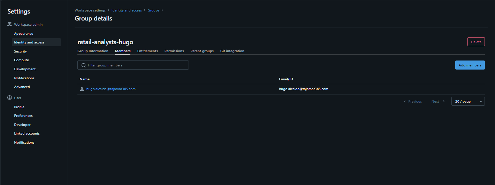
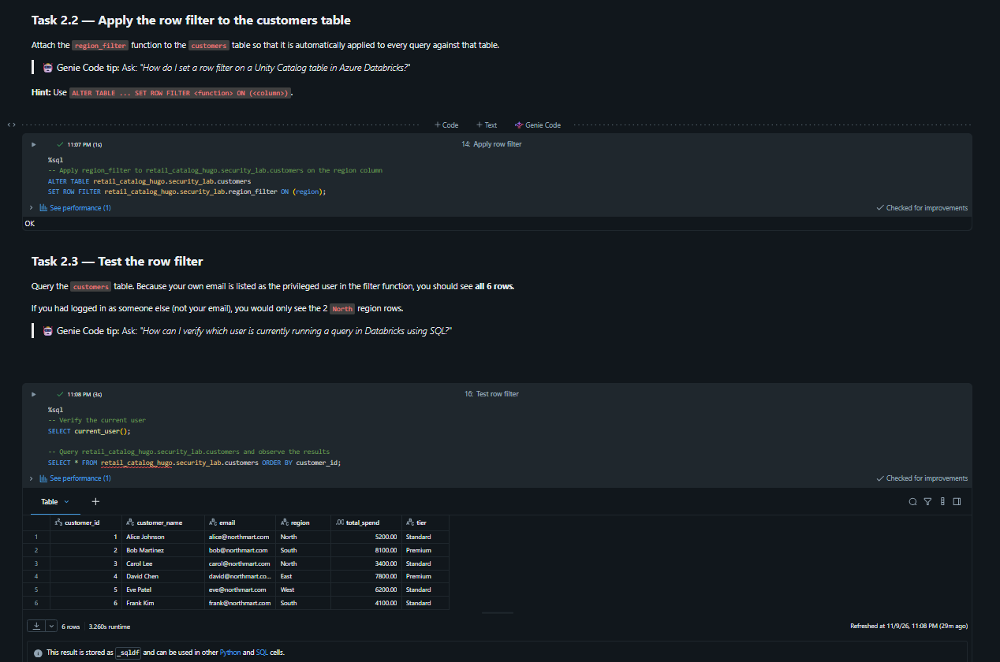
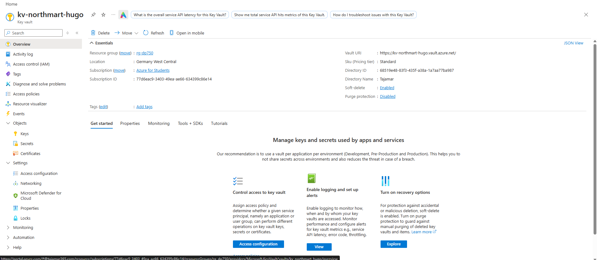
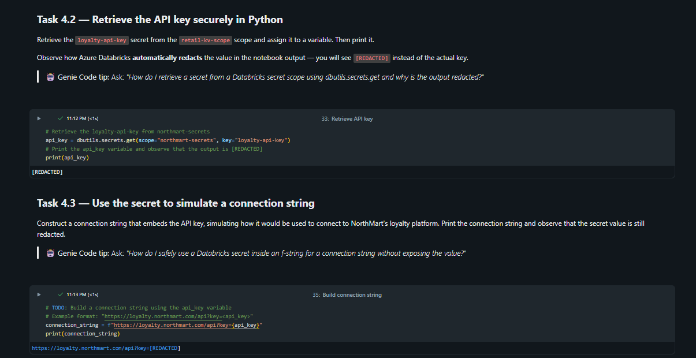

# Lab 04: Secure Unity Catalog Objects (NorthMart Retail)

Implementación y validación de mecanismos de seguridad de grano fino (**Fine-Grained Access Control**) y gestión centralizada de secretos en **Azure Databricks** con **Unity Catalog** y computación **Serverless**.

---

## 1. Contexto y Adaptaciones de Entorno

Para garantizar el aislamiento de recursos y evitar colisiones de concurrencia y permisos en el espacio de trabajo compartido, se definieron parámetros dedicados:

* **Catálogo:** `retail_catalog_hugo` (hereda la ubicación raíz de almacenamiento del metastore).
* **Esquema:** `security_lab`.
* **Tabla gestionada:** `customers` (Delta Lake con 6 registros de clientes).
* **Grupo de analistas:** `retail-analysts-hugo`.
* **Azure Key Vault:** `kv-northmart-hugo` en el grupo de recursos `rg-dp750` (Región: *Germany West Central*).
* **Databricks Secret Scope:** `northmart-secrets` respaldado por Azure Key Vault, gestionando la clave `loyalty-api-key`.

---

## 2. Gestión de Identidades y Control de Acceso (RBAC)

Se configuró el grupo de usuarios `retail-analysts-hugo` a nivel de workspace/cuenta para simular el perfil de analista regional de *NorthMart*, asignando los privilegios estrictamente necesarios siguiendo el modelo de herencia de Unity Catalog (`USE CATALOG` $\rightarrow$ `USE SCHEMA` $\rightarrow$ `SELECT`).



```sql
-- Concesión jerárquica de permisos al grupo personalizado
GRANT USE CATALOG ON CATALOG retail_catalog_hugo TO `retail-analysts-hugo`;
GRANT USE SCHEMA ON SCHEMA retail_catalog_hugo.security_lab TO `retail-analysts-hugo`;
GRANT SELECT ON TABLE retail_catalog_hugo.security_lab.customers TO `retail-analysts-hugo`;

-- Verificación de privilegios asignados
SHOW GRANTS ON TABLE retail_catalog_hugo.security_lab.customers;
```

---

## 3. Seguridad a Nivel de Fila (Row Filters)

Para restringir el acceso a los datos según el contexto del usuario en tiempo de ejecución, se implementó una función UDF escalar con la directiva `is_account_group_member()`. 

* **Regla de negocio:** Los usuarios generales únicamente acceden a registros de la región `North`. Los miembros de `retail-analysts-hugo` poseen visibilidad completa de todas las regiones.

```sql
-- Definición de la función de filtrado
CREATE OR REPLACE FUNCTION retail_catalog_hugo.security_lab.region_filter(region STRING)
RETURNS BOOLEAN
RETURN region = 'North' OR is_account_group_member('retail-analysts-hugo');

-- Vinculación de la directiva sobre la columna de partición lógica
ALTER TABLE retail_catalog_hugo.security_lab.customers
SET ROW FILTER retail_catalog_hugo.security_lab.region_filter ON (region);
```

Al consultar la tabla con el usuario autenticado (perteneciente a `retail-analysts-hugo`), la función evalúa en `TRUE` para todos los registros, retornando las 6 filas completas:



---

## 4. Enmascaramiento Dinámico de Columnas (Column Masks)

Con el propósito de proteger información de identificación personal (**PII**), se configuró una máscara dinámica sobre la columna `email`:

```sql
-- Definición de la función de ofuscación condicional
CREATE OR REPLACE FUNCTION retail_catalog_hugo.security_lab.mask_email(email STRING)
RETURNS STRING
RETURN CASE
  WHEN is_account_group_member('retail-analysts-hugo') THEN email
  ELSE '***@***.com'
END;

-- Aplicación de la máscara sobre la columna email
ALTER TABLE retail_catalog_hugo.security_lab.customers
ALTER COLUMN email SET MASK retail_catalog_hugo.security_lab.mask_email;

-- Consulta de verificación
SELECT customer_id, customer_name, email 
FROM retail_catalog_hugo.security_lab.customers 
ORDER BY customer_id;
```

---

## 5. Gestión de Secretos con Azure Key Vault

Para eliminar cadenas de conexión y credenciales en texto plano dentro del código fuente, se aprovisionó un servicio **Azure Key Vault** en el grupo de recursos del laboratorio:

* **Resource Group:** `rg-dp750`
* **Modelo de permisos:** *Vault access policy*
* **Secreto registrado:** `loyalty-api-key` con estado *Enabled*



### Integración y Secret Scope en Databricks

Se vinculó el almacén en Databricks mediante el endpoint `#secrets/createScope` asociando el **Vault URI** y el **Resource ID** al scope `northmart-secrets`.

La recuperación mediante `dbutils.secrets.get` protege la confidencialidad de la clave en los outputs del motor Spark, garantizando que cualquier interpolación en cadenas de conexión quede automáticamente redactada (`[REDACTED]`):



```python
# Recuperación segura del secreto
api_key = dbutils.secrets.get(scope="northmart-secrets", key="loyalty-api-key")
print(api_key)

# Simulación de endpoint con inyección segura
connection_string = f"[https://loyalty.northmart.com/api?key=](https://loyalty.northmart.com/api?key=){api_key}"
print(connection_string)
```

---

## 6. Conclusiones Técnicas

1. **Gobernanza Unificada:** Unity Catalog permite desacoplar la lógica de seguridad del código de ingesta, aplicando políticas de filtrado de filas y enmascaramiento de columnas a nivel de motor de metadatos.
2. **Cumplimiento y Privacidad:** La combinación de directivas dinámicas (`is_account_group_member`) y enmascaramiento PII asegura que múltiples perfiles consuman la misma tabla Delta respetando normativas como RGPD sin necesidad de mantener vistas redundantes.
3. **Cero Secretos en Código:** La integración nativa entre Azure Key Vault y Databricks Secret Scopes previene fugas de credenciales en logs de ejecución y cuadernos compartidos.