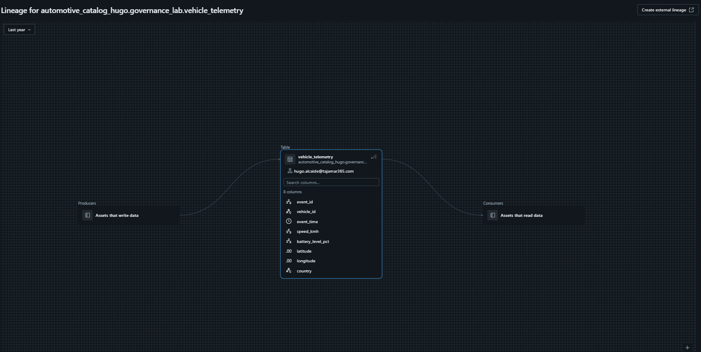
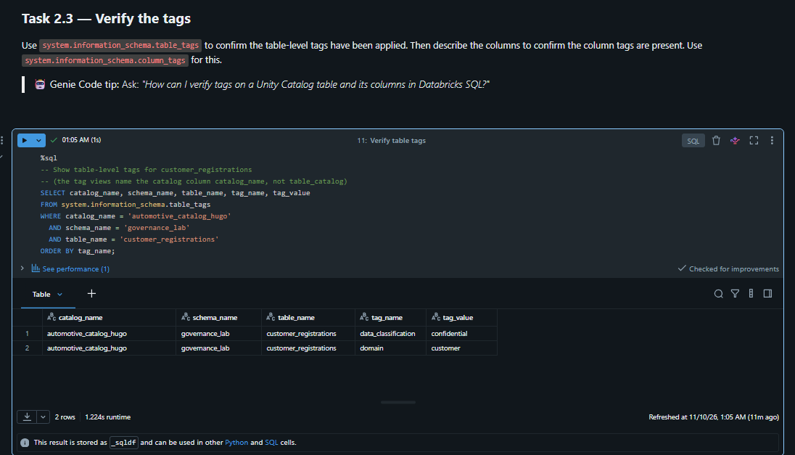
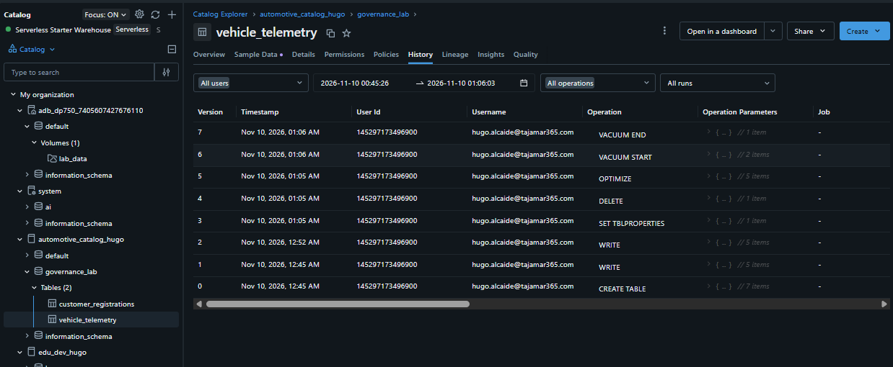
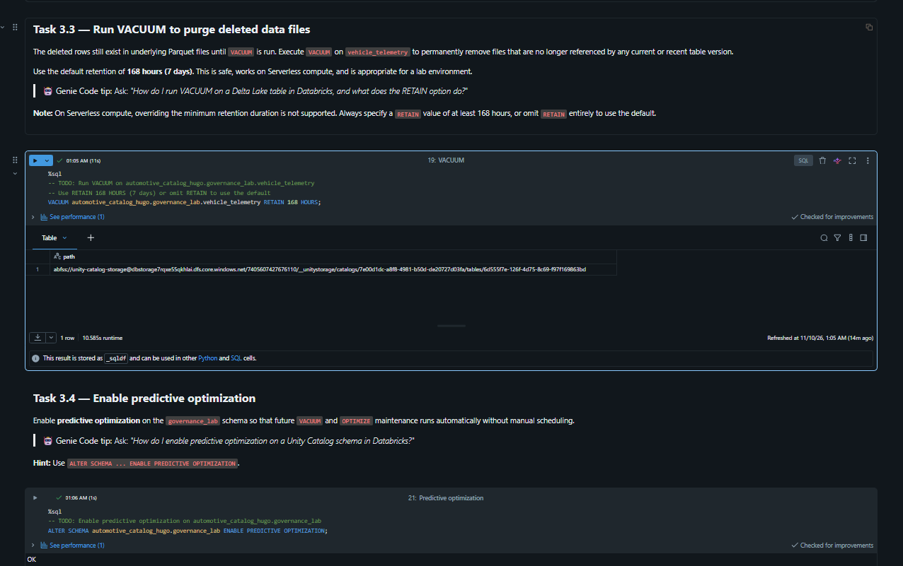

# Lab 05: Govern Unity Catalog Objects (AutoSphere AG)

Implementación y validación de mecanismos avanzados de gobernanza de datos, linaje automatizado, clasificación y etiquetado (PII), ciclo de vida Delta Lake (GDPR) y mantenimiento predictivo en **Azure Databricks** mediante **Unity Catalog** y computación **Serverless**.

---

## 1. Contexto y Adaptaciones del Entorno

En este laboratorio se implementa la arquitectura de datos para la plataforma de vehículos conectados de **AutoSphere AG**. Para evitar colisiones en el espacio de trabajo compartido y garantizar el aislamiento de recursos, se adaptaron los identificadores:

* **Catálogo:** `automotive_catalog_hugo` (hereda la ubicación raíz de almacenamiento administrado del metastore).
* **Esquema:** `governance_lab`.
* **Tablas administradas:**
  * `customer_registrations`: Registro de propietarios, licencias y vehículos asociados.
  * `vehicle_telemetry`: Registro continuo de telemetría (velocidad, estado de batería, geolocalización).
* **Entorno de ejecución:** Databricks Serverless Compute y Serverless Starter Warehouse.

```sql
-- Creación de esquema y tablas base en automotive_catalog_hugo
CREATE SCHEMA IF NOT EXISTS automotive_catalog_hugo.governance_lab
  COMMENT 'Governance lab schema for hands-on Unity Catalog exercises.';

CREATE TABLE IF NOT EXISTS automotive_catalog_hugo.governance_lab.customer_registrations (
  customer_id BIGINT,
  full_name STRING,
  email STRING,
  driver_license_no STRING,
  country STRING,
  vehicle_id STRING
) COMMENT 'One row per registered AutoSphere customer and their associated vehicle.';

CREATE TABLE IF NOT EXISTS automotive_catalog_hugo.governance_lab.vehicle_telemetry (
  event_id BIGINT COMMENT 'Unique telemetry event identifier',
  vehicle_id STRING,
  event_time TIMESTAMP,
  speed_kmh INT COMMENT 'Instantaneous vehicle speed in kilometres per hour',
  battery_level_pct INT COMMENT 'State of charge as a percentage (0-100)',
  latitude DOUBLE,
  longitude DOUBLE,
  country STRING
);
```

---

## 2. Linaje de Datos Automatizado (Data Lineage)

Unity Catalog registra de forma nativa e inmutable el flujo de datos de extremo a extremo sin requerir instrumentación de código adicional. A través del grafo visual de linaje se auditan tanto los productores (*Producers*, notebooks y procesos de ingesta) como los consumidores (*Consumers*, dashboards o transformaciones posteriores).

* **Resolución a nivel de columna:** Permite rastrear la procedencia de atributos críticos como `vehicle_id` o métricas de estado como `speed_kmh` y `battery_level_pct`.



---

## 3. Clasificación de Datos y Etiquetas de Gobernanza (Tags)

Para dar soporte a auditorías de cumplimiento normativo y habilitar el descubrimiento automatizado de activos, se aplicaron etiquetas semánticas tanto a nivel de tabla como de columna para catalogar información de identificación personal (**PII**).

### Aplicación de Tags

```sql
-- Tags a nivel de tabla
ALTER TABLE automotive_catalog_hugo.governance_lab.customer_registrations
SET TAGS (
  'domain' = 'customer',
  'data_classification' = 'confidential'
);

-- Tags a nivel de columna para campos sensibles (PII)
ALTER TABLE automotive_catalog_hugo.governance_lab.customer_registrations
ALTER COLUMN email SET TAGS ('pii' = 'email');

ALTER TABLE automotive_catalog_hugo.governance_lab.customer_registrations
ALTER COLUMN driver_license_no SET TAGS ('pii' = 'driver_license');
```

### Verificación mediante Catálogo de Sistema (`system.information_schema`)

Se consultaron las vistas de metadatos del sistema para verificar la correcta asignación e indexación de las etiquetas:

```sql
SELECT catalog_name, schema_name, table_name, tag_name, tag_value
FROM system.information_schema.table_tags
WHERE catalog_name = 'automotive_catalog_hugo'
  AND schema_name = 'governance_lab'
  AND table_name = 'customer_registrations'
ORDER BY tag_name;
```



---

## 4. Ciclo de Vida Delta Lake, Retención y Cumplimiento GDPR

En cumplimiento con el principio de minimización de datos del **RGPD** y el derecho al olvido, se configuraron ventanas de retención estrictas y se procedió a la eliminación irreversible de registros asociados a un vehículo específico.

### Configuración de Propiedades de Retención

```sql
ALTER TABLE automotive_catalog_hugo.governance_lab.vehicle_telemetry
SET TBLPROPERTIES (
  'delta.logRetentionDuration' = 'interval 14 days',
  'delta.deletedFileRetentionDuration' = 'interval 14 days'
);
```

### Simulación de Solicitud de Eliminación (Derecho al Olvido)

```sql
-- Eliminación de registros vinculados al vehículo VH-003
DELETE FROM automotive_catalog_hugo.governance_lab.vehicle_telemetry
WHERE vehicle_id = 'VH-003';
```

### Auditoría del Registro de Transacciones (`Delta History`)

Cada operación ejecutada sobre la tabla Delta genera un commit atómico en el log de transacciones (`_delta_log`). El análisis de versiones refleja la trazabilidad completa desde la creación hasta las operaciones de mantenimiento:



* **Versión 0 a 2:** Creación inicial e ingesta de registros telemétricos (`CREATE TABLE`, `WRITE`).
* **Versión 3:** Modificación de metadatos de retención (`SET TBLPROPERTIES`).
* **Versión 4:** Ejecución de la baja por privacidad (`DELETE`).
* **Versión 5:** Compactación de ficheros pequeños (`OPTIMIZE`).
* **Versión 6 y 7:** Inicio y conclusión de la purga física de archivos huérfanos (`VACUUM START`, `VACUUM END`).

---

## 5. Mantenimiento del Almacenamiento y Optimización Predictiva

### Purga de Archivos Físicos con VACUUM

La instrucción `DELETE` en Delta Lake realiza un borrado lógico; los ficheros Parquet antiguos continúan existiendo para permitir *Time Travel*. Para eliminar físicamente los archivos que ya no están referenciados y liberar almacenamiento, se ejecutó `VACUUM`.

> **Nota técnica de Serverless:** Para prevenir pérdidas de datos accidentales, los entornos Serverless imponen una comprobación de seguridad mínima de retención de 168 horas (7 días), no permitiendo desactivar dicha comprobación mediante flags de sesión.

```sql
VACUUM automotive_catalog_hugo.governance_lab.vehicle_telemetry RETAIN 168 HOURS;
```

### Optimización Predictiva (Predictive Optimization)

Para delegar la gestión operativa de tareas recurrentes como compactación de archivos binarios (`OPTIMIZE`) y purga periódica (`VACUUM`) a los modelos heurísticos de Databricks, se activó la optimización predictiva a nivel de esquema:

```sql
ALTER SCHEMA automotive_catalog_hugo.governance_lab
ENABLE PREDICTIVE OPTIMIZATION;
```



---

## 6. Auditoría y Consultas al Metastore (`system.access`)

Para la gobernanza de accesos, Unity Catalog dispone de esquemas del sistema accesibles vía SQL:

```sql
-- Auditoría de accesos a tablas de clientes
SELECT 
  user_identity.email,
  action_name,
  event_time
FROM system.access.audit
WHERE (
    request_params.full_name_arg = 'automotive_catalog_hugo.governance_lab.customer_registrations'
    OR request_params.table_name = 'customer_registrations'
  )
  AND action_name IN ('getTable', 'createTable')
  AND event_time >= CURRENT_TIMESTAMP() - INTERVAL 30 DAYS
ORDER BY event_time DESC;
```

---

## 7. Conclusiones Técnicas

1. **Gobernanza Centralizada:** Unity Catalog centraliza las directivas de seguridad, catalogación y linaje bajo un único plano de control, abstrayendo al usuario de la capa de almacenamiento física en Azure Data Lake Storage.
2. **Cumplimiento Normativo (RGPD):** La combinación de etiquetas PII en el catálogo y comandos DML (`DELETE` + `VACUUM`) garantiza la trazabilidad y ejecución efectiva del derecho a la supresión de datos personales.
3. **Mantenimiento Autónomo:** La activación de *Predictive Optimization* permite que la plataforma administre de manera proactiva la salud del almacenamiento en Delta Lake sin sobrecargar a los ingenieros de datos con pipelines de mantenimiento manuales.