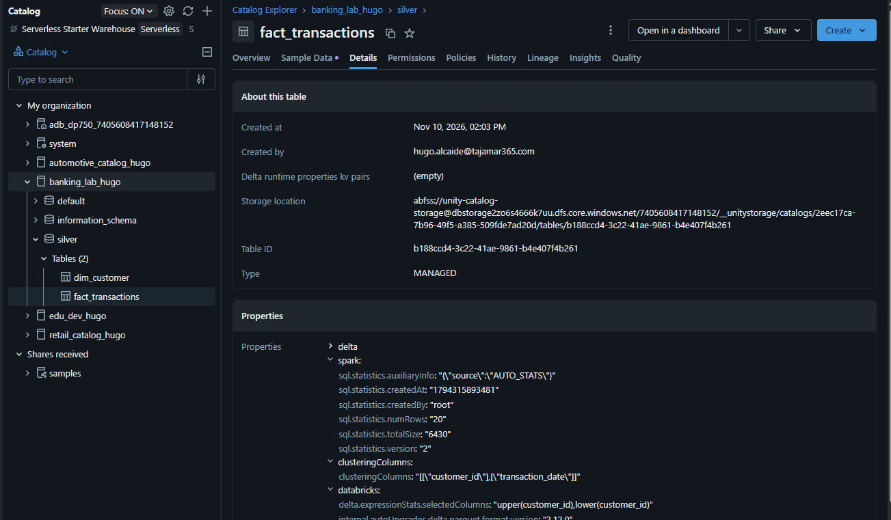
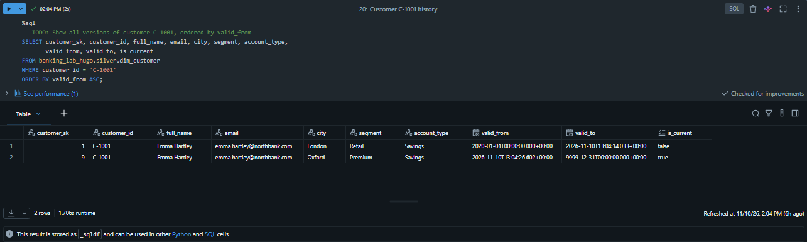
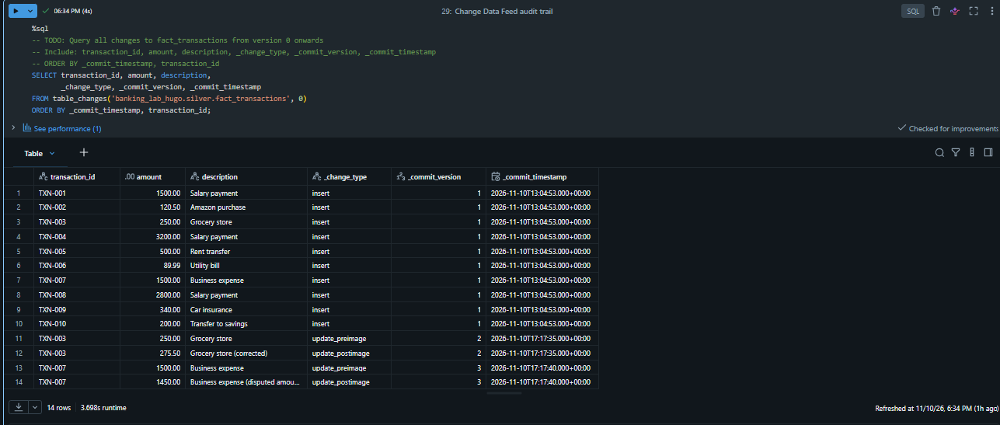
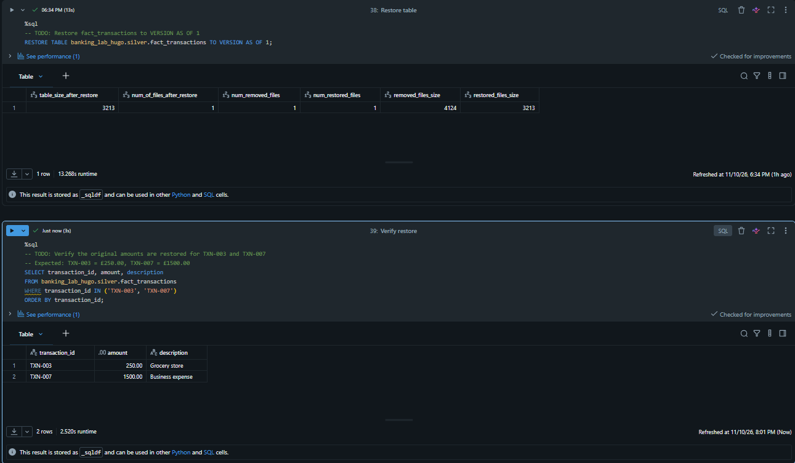

# Lab 06: Design and Implement Data Modeling with Azure Databricks (Northbank Financial)

## 1. Contexto y Objetivos del Escenario
Northbank Financial es una entidad bancaria minorista en el Reino Unido que requiere modernizar su plataforma Lakehouse sobre Azure Databricks para analítica de clientes, cumplimiento de regulaciones bancarias (Basel III, FCA) y detección de fraude.

### Objetivos técnicos implementados:
- **Modelo de datos gobernado en Unity Catalog**: Creación de tablas gestionadas (*Managed Delta Tables*) optimizadas para almacenamiento corporativo.
- **Optimización de lectura con Liquid Clustering**: Reemplazo de particionado estático por clustering dinámico multidimensional (`CLUSTER BY`) en hechos de transacciones.
- **Dimensiones de Cambio Lento (SCD Tipo 2)**: Trazabilidad histórica completa del perfil de clientes mediante el patrón `MERGE` + `INSERT`.
- **Auditoría regulatoria con Change Data Feed (CDF)**: Captura a bajo nivel de modificaciones transaccionales vía `table_changes()`.
- **Recuperación ante desastres con Delta Time Travel**: Restauración de estado puntual en tablas sin necesidad de copias de seguridad externas (`RESTORE TABLE`).

---

## 2. Decisiones de Arquitectura y Optimización de Costes

### Liquid Clustering vs Particionado Tradicional
En `fact_transactions`, las consultas analíticas combinan filtros por cliente y rangos temporales. El particionado tradicional por directorio (`PARTITIONED BY (transaction_date)`) genera el problema de los ficheros pequeños (*small files problem*) ante volúmenes medianos o ráfagas continuas. Se aplicó **Liquid Clustering** con:
```sql
CLUSTER BY (customer_id, transaction_date)
```
Esto permite a Databricks reescribir los datos incrementalmente sin reescribir particiones enteras, mejorando el data skipping y reduciendo el cómputo en consultas selectivas.

### Entorno de Cómputo Serverless
Todas las transformaciones y consultas se ejecutaron bajo **Serverless Compute**, eliminando tiempos de arranque de máquinas virtuales y reduciendo el consumo de DBUs a los segundos exactos de CPU utilizados.

---

## 3. Implementación Paso a Paso y Evidencias

### Paso 1: Creación del Modelo y Verificación de Tablas Gestionadas
Se aprovisionó el catálogo `banking_lab_hugo` y el esquema `silver`, creando la dimensión `dim_customer` y la tabla de hechos `fact_transactions`.


*Figura 1: Verificación en Catalog Explorer de la tabla gestionada `fact_transactions` con Liquid Clustering activo sobre `(customer_id, transaction_date)` y almacenamiento gobernado por Unity Catalog.*

---

### Paso 2: Implementación de SCD Tipo 2 (MERGE + INSERT)
Para mantener el historial completo de cambios de atributos de clientes (como cambios de ciudad de residencia o nivel de segmento), se implementó el ciclo SCD Tipo 2:
1. **Cierre de versión activa:** Se utiliza `MERGE INTO` contra la tabla staging; cuando hay discrepancia en atributos rastreados, se actualiza `is_current = false` y `valid_to = current_timestamp()`.
2. **Inserción de nueva versión:** Se inserta el nuevo registro con `is_current = true`, `valid_from = current_timestamp()` y `valid_to = '9999-12-31'`.

```sql
SELECT customer_sk, customer_id, full_name, email, city, segment, account_type,
       valid_from, valid_to, is_current
FROM banking_lab_hugo.silver.dim_customer
WHERE customer_id = 'C-1001'
ORDER BY valid_from ASC;
```


*Figura 2: Consulta de historial para el cliente C-1001 mostrando la fila histórica cerrada en Londres/Retail y la fila vigente activa en Oxford/Premium.*

---

### Paso 3: Auditoría y Cumplimiento FCA con Change Data Feed (CDF)
Habilitando la propiedad `delta.enableChangeDataFeed = true`, se simuló la corrección de importes transaccionales y se auditó el registro histórico mediante la función tabular `table_changes()`:

```sql
SELECT transaction_id, amount, description,
       _change_type, _commit_version, _commit_timestamp
FROM table_changes('banking_lab_hugo.silver.fact_transactions', 0)
ORDER BY _commit_timestamp, transaction_id;
```


*Figura 3: Traza de auditoría donde se identifican las operaciones de inserción y las parejas `update_preimage` (valor previo) y `update_postimage` (valor corregido).*

---

### Paso 4: Recuperación de Datos con Delta Lake Time Travel
Ante un error operativo en correcciones de saldo, se utilizó el log transaccional de Delta Lake para consultar el estado en la versión 1 y revertir los cambios de forma idempotente:

```sql
-- Reversión a estado previo sin backups externos
RESTORE TABLE banking_lab_hugo.silver.fact_transactions TO VERSION AS OF 1;
```


*Figura 4: Ejecución del comando RESTORE TABLE y confirmación de importes restaurados a los valores originales (£250.00 y £1500.00).*

---

## 4. Conclusiones Técnicas
1. **Gobernanza Centralizada:** Unity Catalog asegura el ciclo de vida del dato mediante tablas gestionadas, aislando los ficheros subyacentes de manipulaciones directas no auditadas.
2. **Consultas Temporales Robustas:** La combinación de surrogate keys incrementales y rangos `valid_from` / `valid_to` permite responder a requerimientos regulatorios puntuales (*Point-in-time lookup*) con integridad relacional garantizada.
3. **Resiliencia Operativa:** Change Data Feed y Time Travel proporcionan un doble mecanismo de seguridad: trazabilidad total de quién modificó cada dato y capacidad de rollback inmediata ante incidentes en producción.