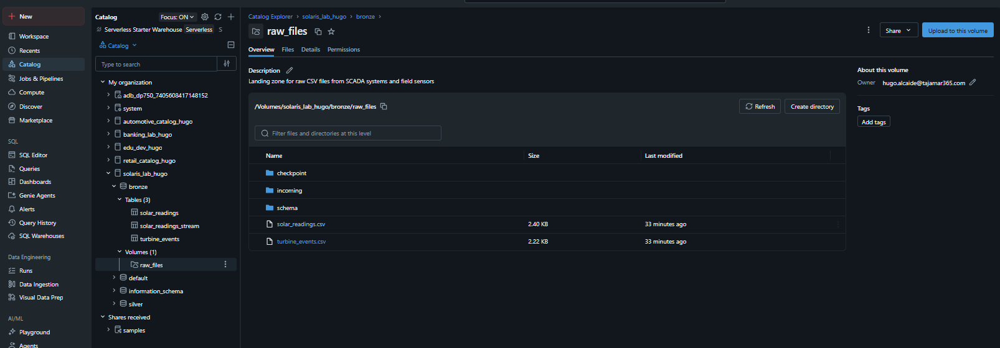
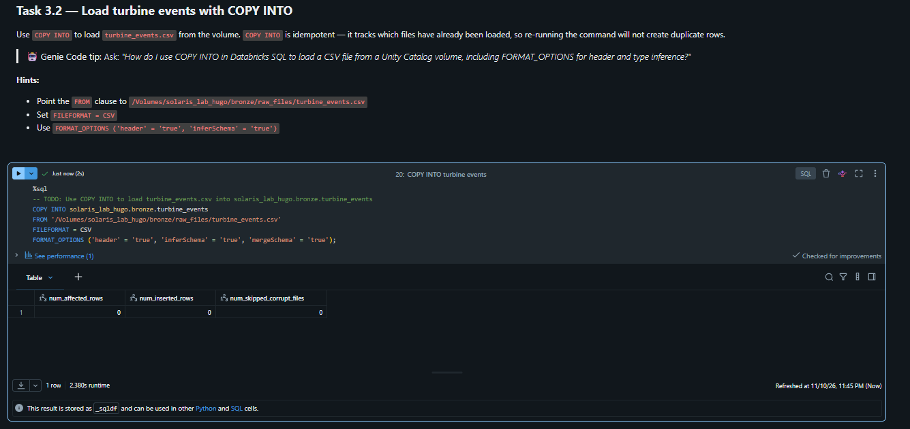
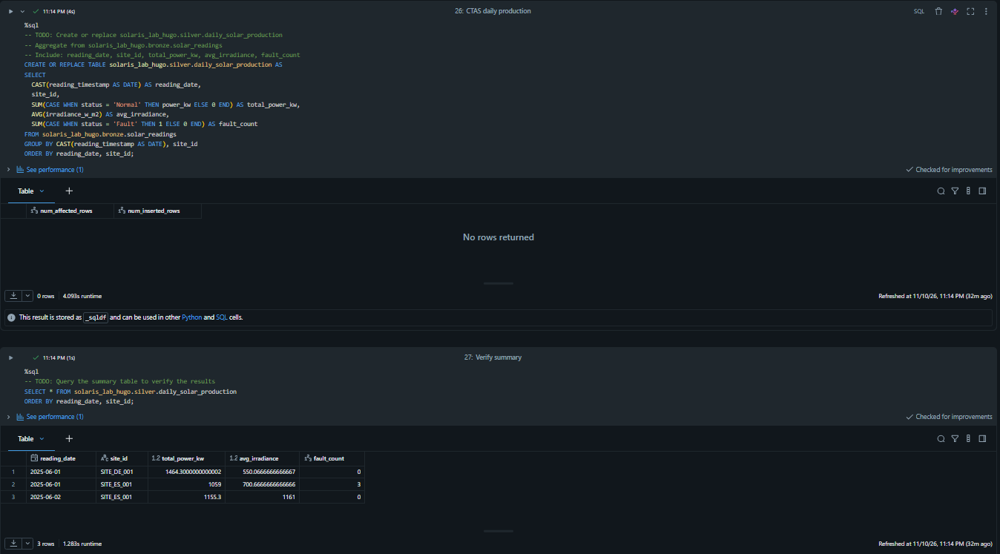
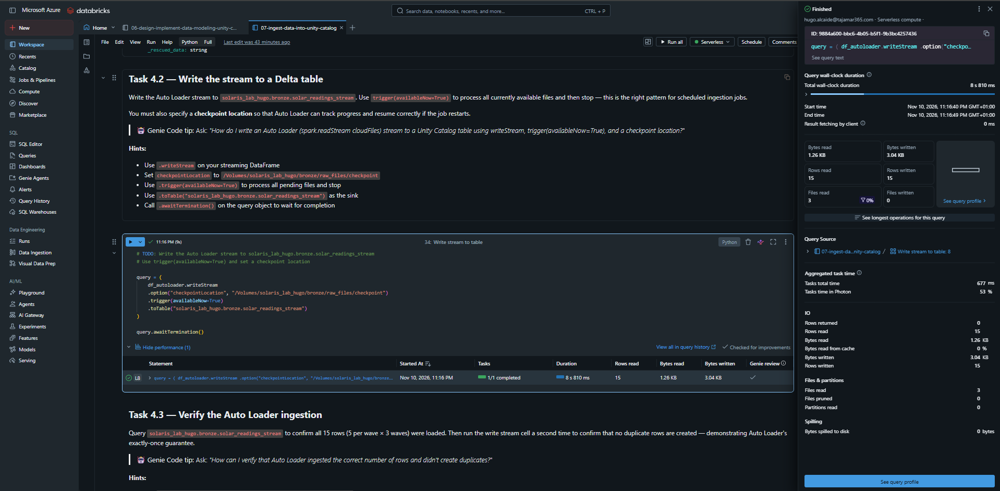

# Lab 07: Ingest Data into Unity Catalog (Solaris Energy)

## 1. Contexto y Objetivos del Escenario
Solaris Energy opera parques solares y eólicos en Europa que generan telemetría SCADA en tiempo real y eventos de mantenimiento. La compañía necesita estandarizar la ingesta de ficheros semiestructurados (CSV) hacia Azure Databricks, garantizando gobernanza centralizada, deduplicación nativa y procesamiento eficiente de datos en streaming.

### Objetivos técnicos implementados:
- **Almacenamiento gobernado con Unity Catalog Volumes**: Creación de un volumen gestionado (`Managed Volume`) como zona de aterrizaje (*landing zone*) para ficheros crudos sin necesidad de configurar montajes de almacenamiento externos heredados (DBFS).
- **Ingesta incremental idempotente con `COPY INTO`**: Carga controlada de eventos de turbinas eólicas con detección automática de ficheros procesados y evolución de esquema (`mergeSchema`).
- **Transformación y agregación analítica con CTAS**: Materialización de métricas de producción solar y fallos operativos agregados por fecha y emplazamiento mediante `CREATE TABLE AS SELECT`.
- **Ingesta escalable con Auto Loader (`cloudFiles`)**: Procesamiento continuo de telemetría de paneles solares con inferencia de esquema, captura de datos no estructurados/corruptos vía `_rescued_data` y ejecución optimizada para control de costes.

---

## 2. Decisiones de Arquitectura y Optimización de Costes

### Unity Catalog Volumes vs Montajes de Almacenamiento (DBFS Mounts)
En lugar de depender de montajes tradicionales en `/mnt/`, se implementó un **Managed Volume** dentro del esquema `bronze`. Esto aporta:
- Control de acceso unificado basado en privilegios de Unity Catalog (ANSI SQL `GRANT`/`REVOKE`).
- Rutas POSIX transparentes (`/Volumes/solaris_lab_hugo/bronze/raw_files/`) utilizables directamente por librerías nativas de Python y Spark.
- Eliminación de credenciales estáticas o secretos compartidos en el código.

### Auto Loader (`cloudFiles`) con `trigger(availableNow=True)`
En arquitecturas de producción bajo cómputo **Serverless**, mantener un stream continuo (`processingTime='10 seconds'`) con flujos de llegada intermitentes genera costes innecesarios por inactividad. Se utilizó la estrategia:
```python
.trigger(availableNow=True)
```
Esto permite a Auto Loader descubrir incrementalmente todos los ficheros pendientes en el volumen, procesarlos en micro-lotes de alta eficiencia y finalizar la ejecución (`awaitTermination`) automáticamente, reduciendo el consumo de DBUs al tiempo exacto de cómputo requerido.

---

## 3. Implementación Paso a Paso y Evidencias

### Paso 1: Aprovisionamiento de Volúmenes y Landing Zone
Se estructuró la jerarquía en Unity Catalog (`solaris_lab_hugo.bronze`) y se aprovisionó el volumen gestionado `raw_files`, alojando los ficheros CSV de lecturas solares y eventos de turbinas.


*Figura 1: Explorador de catálogo mostrando el volumen gestionado `raw_files` con los subdirectorios de checkpoints, esquemas e incoming, junto a los ficheros crudos `solar_readings.csv` y `turbine_events.csv`.*

---

### Paso 2: Ingesta Incremental e Idempotente con `COPY INTO`
Se utilizó el comando `COPY INTO` para cargar los eventos de turbinas eólicas (`turbine_events`) preservando idempotencia operativa ante reintentos de pipeline:

```sql
COPY INTO solaris_lab_hugo.bronze.turbine_events
FROM '/Volumes/solaris_lab_hugo/bronze/raw_files/turbine_events.csv'
FILEFORMAT = CSV
FORMAT_OPTIONS ('header' = 'true', 'inferSchema' = 'true', 'mergeSchema' = 'true');
```


*Figura 2: Verificación de idempotencia; al reejecutar la sentencia `COPY INTO`, el motor omite los ficheros previamente procesados (`num_affected_rows = 0`, `num_inserted_rows = 0`), evitando duplicidad de registros.*

---

### Paso 3: Agregación Analítica mediante CTAS (`CREATE TABLE AS SELECT`)
Para servir datos agregados a la capa Silver sin coste computacional recurrente de vistas dinámicas, se generó la tabla agregada `daily_solar_production`:

```sql
CREATE OR REPLACE TABLE solaris_lab_hugo.silver.daily_solar_production AS
SELECT 
    CAST(reading_timestamp AS DATE) AS reading_date,
    site_id,
    SUM(CASE WHEN status = 'Normal' THEN power_kw ELSE 0 END) AS total_power_kw,
    AVG(irradiance_w_m2) AS avg_irradiance,
    SUM(CASE WHEN status = 'Fault' THEN 1 ELSE 0 END) AS fault_count
FROM solaris_lab_hugo.bronze.solar_readings
GROUP BY CAST(reading_timestamp AS DATE), site_id
ORDER BY reading_date, site_id;
```


*Figura 3: Ejecución de la sentencia CTAS y verificación mediante SELECT de los totales de energía, irradiancia media y conteo de fallos por parque solar.*

---

### Paso 4: Ingesta Continua y Rescate de Datos con Auto Loader
Se configuró **Databricks Auto Loader** (`format("cloudFiles")`) para procesar lecturas solares entrantes por lotes, garantizando la persistencia del estado en checkpoints y rescate de columnas corruptas:

```python
query = (
    df_autoloader.writeStream
    .option("checkpointLocation", "/Volumes/solaris_lab_hugo/bronze/raw_files/checkpoint")
    .trigger(availableNow=True)
    .toTable("solaris_lab_hugo.bronze.solar_readings_stream")
)
query.awaitTermination()
```


*Figura 4: Finalización del stream en modo Serverless procesando 15 filas y 3 ficheros crudos sin fallos, con control estricto de finalización para evitar facturación en segundo plano.*

---

## 4. Conclusiones Técnicas
1. **Modernización de Ingesta:** Unity Catalog Volumes simplifica la capa de ingesta eliminando configuraciones complejas de credenciales de almacenamiento en notebooks o clústeres.
2. **Selección del Mecanismo de Ingesta:** `COPY INTO` resulta óptimo para cargas por lotes idempotentes de miles de archivos, mientras que `Auto Loader` es la solución preferente cuando el volumen escala a millones de archivos o requiere detección continua de esquemas evolutivos.
3. **Optimización Financiera:** El desacoplamiento entre almacenamiento y cómputo serverless con patrones `availableNow=True` maximiza la rentabilidad operativa del Lakehouse.