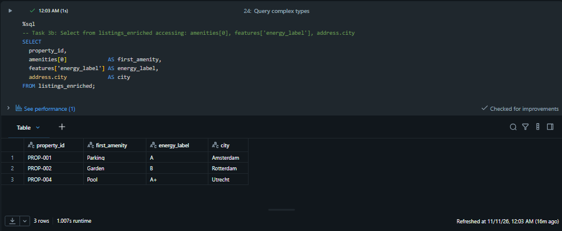
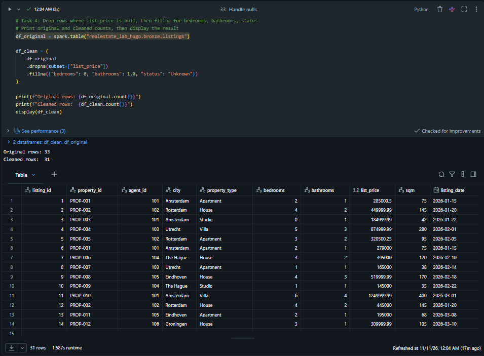
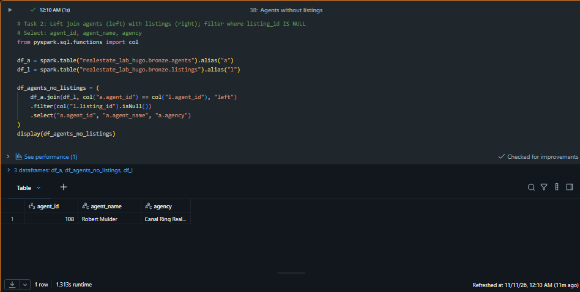
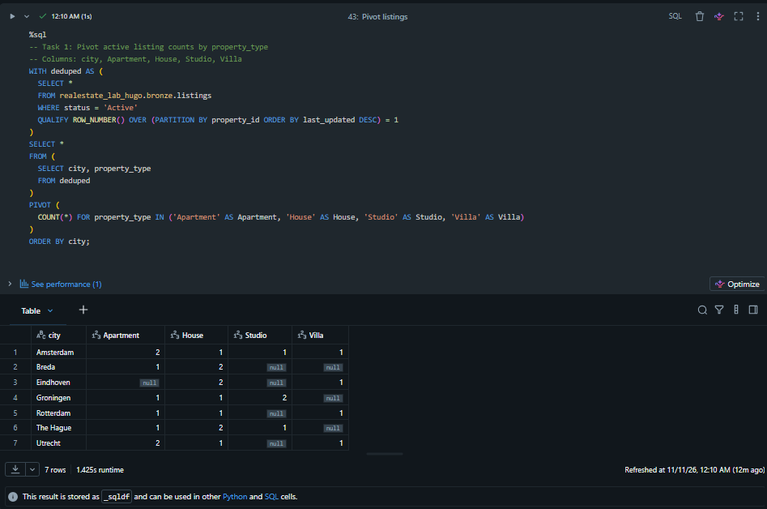

# Lab 08: Cleanse, Transform, and Load Data into Unity Catalog (Pristine Properties)

## 1. Contexto y Objetivos del Escenario
Pristine Properties es una plataforma de analítica inmobiliaria que opera en diversas ciudades de los Países Bajos (Ámsterdam, Róterdam, Utrecht, La Haya, Eindhoven, Groninga y Breda). La compañía recibe ficheros CSV desde múltiples agencias con problemas habituales de calidad: duplicados por actualizaciones de precio, valores nulos en atributos críticos y formatos matriciales que dificultan el análisis directo.

### Objetivos técnicos implementados:
- **Perfilado estadístico y optimización**: Recolección de métricas del optimizador de consultas mediante `ANALYZE TABLE` y perfilado descriptivo en PySpark.
- **Tipado estricto y estructuras anidadas**: Uso de `DECIMAL(12,2)` frente a `DOUBLE` para evitar errores de redondeo binario en precios, `TIMESTAMP_NTZ` para citas locales y estructuras complejas (`ARRAY`, `MAP`, `STRUCT`).
- **Deduplicación determinista y limpieza de nulos**: Resolución de registros duplicados conservando la última actualización mediante funciones de ventana (`ROW_NUMBER` / `QUALIFY`) y reglas de imputación (`dropna` / `fillna`).
- **Integración relacional y remodelado matricial**: Cruces entre catálogos de propiedades, agentes y ventas (`INNER JOIN`, `LEFT ANTI JOIN`) y rotación de ejes mediante `PIVOT` y `UNPIVOT`.

---

## 2. Decisiones de Arquitectura y Troubleshooting de Ingeniería

Durante la implementación de los pipelines sobre Unity Catalog, se identificaron y corrigieron los siguientes retos técnicos:

### 1. Aislamiento de Gobernanza en Unity Catalog (`PERMISSION_DENIED`)
- **Problema:** Los entornos compartidos referenciaban catálogos genéricos (`banking_lab`, `solaris_lab`, `realestate_lab`) sin permisos de escritura por políticas de seguridad.
- **Solución:** Aprovisionamiento de espacios de nombres propios (`banking_lab_hugo`, `solaris_lab_hugo`, `realestate_lab_hugo`) heredando dinámicamente el `Storage Root` del workspace mediante introspección del catálogo con `DESCRIBE CATALOG EXTENDED`.

### 2. Deduplicación Determinista en PySpark (`Window` vs `dropDuplicates`)
- **Problema:** El patrón estándar `df.orderBy(col("last_updated").desc()).dropDuplicates(["property_id"])` es no determinista en Apache Spark, ya que `dropDuplicates` utiliza particionamiento hash que no garantiza preservar el orden previo tras un *shuffle*.
- **Solución:** Se reemplazó por una función de ventana determinista particionada por `property_id` y ordenada por `last_updated DESC`, filtrando explícitamente `row_number() == 1` (pasando de 33 a 30 registros únicos garantizados).

### 3. Integridad Analítica en `PIVOT` con Deduplicación Previa
- **Problema:** Ejecutar `PIVOT` directamente sobre la tabla `bronze.listings` inflaba el conteo de inmuebles activos (ej. Ámsterdam reportaba 3 apartamentos en lugar de 2) debido a las actualizaciones históricas de `PROP-001`, `PROP-002` y `PROP-003`.
- **Solución:** Se encapsuló una expresión de tabla común (`CTE`) aplicando `QUALIFY ROW_NUMBER() OVER (PARTITION BY property_id ORDER BY last_updated DESC) = 1` antes de proyectar las columnas de la matriz.

---

## 3. Implementación Paso a Paso y Evidencias

### Paso 1: Manejo de Tipos de Datos Complejos (`ARRAY`, `MAP`, `STRUCT`)
Para modelar atributos flexibles de cada inmueble sin multiplicar tablas relacionales, se estructuraron listas de comodidades (`ARRAY`), etiquetas energéticas (`MAP`) y direcciones postales (`STRUCT`):

```sql
SELECT
  property_id,
  amenities[0]             AS first_amenity,
  features['energy_label'] AS energy_label,
  address.city             AS city
FROM listings_enriched;
```


*Figura 1: Consulta SQL extrayendo elementos posicionales de un ARRAY, claves de un MAP y atributos anidados de un STRUCT.*

---

### Paso 2: Reglas de Calidad e Imputación de Valores Nulos
Se aplicaron reglas de negocio sobre los listados: descarte de propiedades retiradas sin precio de salida (`list_price IS NULL`) e imputación de valores por defecto en estudios sin habitaciones separadas (`bedrooms = 0`), baños (`1.0`) y estado (`Unknown`):

```python
df_original = spark.table("realestate_lab_hugo.bronze.listings")

df_clean = (
    df_original
    .dropna(subset=["list_price"])
    .fillna({"bedrooms": 0, "bathrooms": 1.0, "status": "Unknown"})
)

print(f"Original rows: {df_original.count()}")
print(f"Cleaned rows:  {df_clean.count()}")
display(df_clean)
```


*Figura 2: Ejecución del pipeline de limpieza reduciendo de 33 a 31 registros válidos e imputando valores por defecto en columnas incompletas.*

---

### Paso 3: Análisis Relacional de Agentes sin Cartera Activa
Mediante un `LEFT JOIN` defensivo entre el maestro de agentes y las propiedades publicadas filtrando claves nulas en el lado derecho (`l.listing_id IS NULL`), se identificaron los agentes comerciales sin captaciones activas:

```python
from pyspark.sql.functions import col

df_a = spark.table("realestate_lab_hugo.bronze.agents").alias("a")
df_l = spark.table("realestate_lab_hugo.bronze.listings").alias("l")

df_agents_no_listings = (
    df_a.join(df_l, col("a.agent_id") == col("l.agent_id"), "left")
    .filter(col("l.listing_id").isNull())
    .select("a.agent_id", "a.agent_name", "a.agency")
)
display(df_agents_no_listings)
```


*Figura 3: Detección del agente 108 (Robert Mulder - Canal Ring Realty) sin propiedades asignadas en el catálogo activo.*

---

### Paso 4: Remodelado Matricial (`PIVOT`) sobre Datos Deduplicados
Para generar el cuadro de mando de oferta inmobiliaria por ciudad y tipología de vivienda, se deduplicó el estado más reciente de cada propiedad activa antes de rotar las filas a columnas:

```sql
WITH deduped AS (
  SELECT *
  FROM realestate_lab_hugo.bronze.listings
  WHERE status = 'Active'
  QUALIFY ROW_NUMBER() OVER (PARTITION BY property_id ORDER BY last_updated DESC) = 1
)
SELECT *
FROM (
  SELECT city, property_type
  FROM deduped
)
PIVOT (
  COUNT(*) FOR property_type IN ('Apartment' AS Apartment, 'House' AS House, 'Studio' AS Studio, 'Villa' AS Villa)
)
ORDER BY city;
```


*Figura 4: Matriz pivotada mostrando la distribución exacta y libre de duplicados de inmuebles activos por ciudad y categoría.*

---

## 4. Conclusiones Técnicas
1. **Precisión Financiera y Temporal:** El uso de `DECIMAL(12,2)` elimina desviaciones de coma flotante en importes agregados, mientras que `TIMESTAMP_NTZ` garantiza que las citas comerciales locales no sufran desplazamientos horarios al cambiar la zona de sesión del clúster.
2. **Determinismo en Pipelines Distribuídos:** En entornos Spark, las operaciones de deduplicación basadas en orden temporal deben apoyarse siempre en `Window.partitionBy().orderBy()` o `QUALIFY ROW_NUMBER()` en lugar de `dropDuplicates()`.
3. **Flexibilidad de Esquema:** El soporte nativo para tipos complejos (`ARRAY`, `MAP`, `STRUCT`) y operadores de rotación (`PIVOT`/`UNPIVOT`) permite adaptar el modelo físico tanto a cargas semiestructuradas como a consumo directo en herramientas de BI.