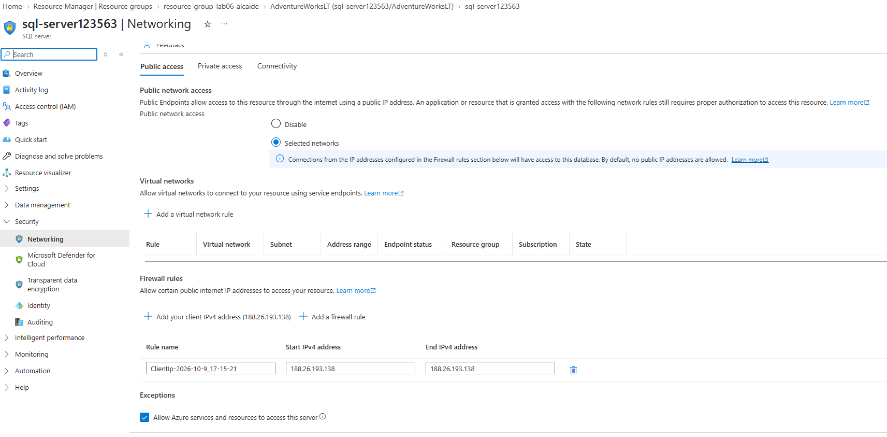
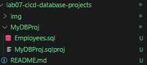
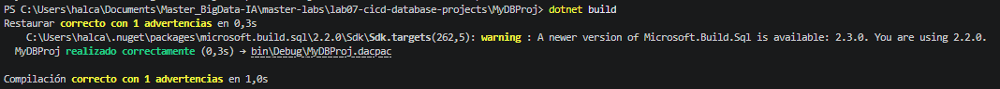
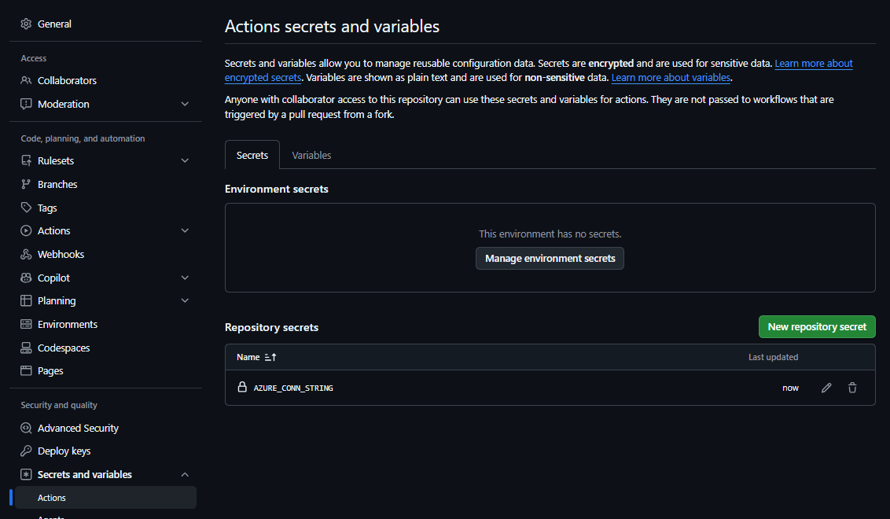
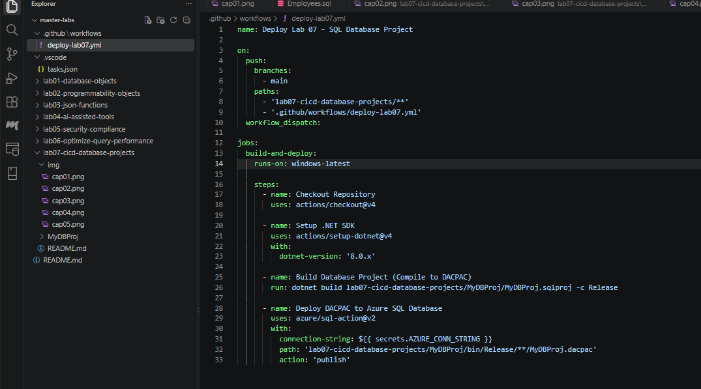
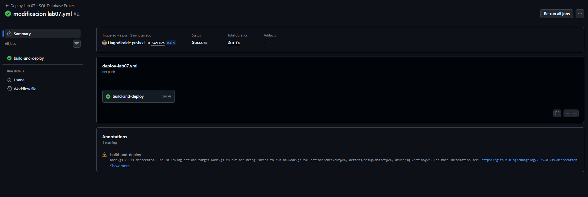
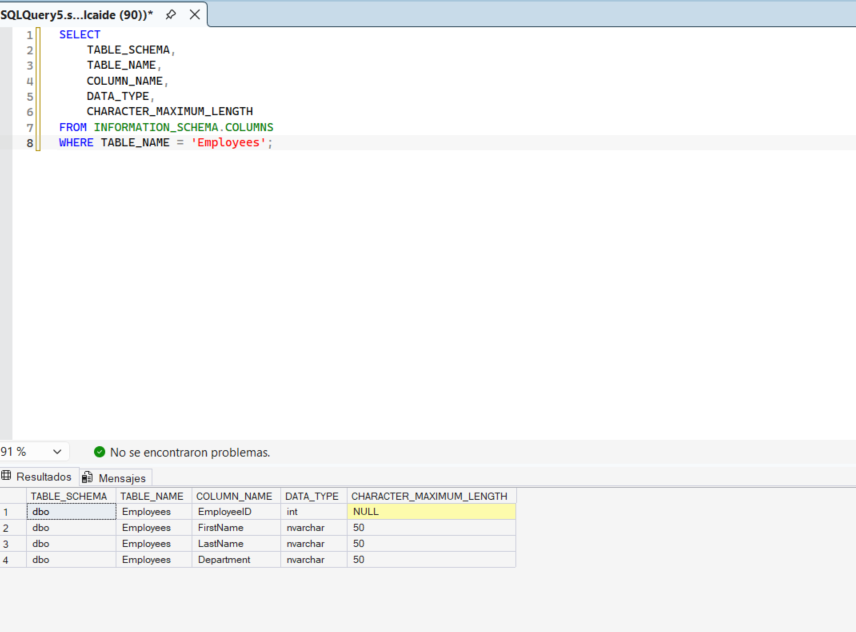

# Laboratorio 07: Implementación de CI/CD con SQL Database Projects

## 📋 Información General y Entorno
* **Módulo:** Optimización, Despliegue y Administración de Bases de Datos en la Nube
* **Laboratorio:** Lab 07 - Implement CI/CD by using SQL database projects
* **Estructura del Proyecto:** Monorepo (`master-labs`)
* **Herramientas:** Visual Studio Code, SQL Database Projects Extension, .NET SDK 8.0, GitHub Actions, SQL Server Management Studio (SSMS) v20.x
* **Infraestructura Cloud:** Azure SQL Database (Serverless Gen5, 1 vCore) sobre Azure for Students
* **Servidor Lógico:** `sql-server123563.database.windows.net`
* **Base de Datos Destino:** `AdventureWorksLT`

> **Nota de optimización de infraestructura:**  
> Siguiendo las directrices del programa formativo, se reutilizó el servidor lógico y grupo de recursos provisionado en el laboratorio previo (`resource-group-lab06-alcaide`), optimizando cuotas de cómputo y créditos de suscripción.

---

## 🎯 Objetivos Técnicos
1. Migrar del modelo de desarrollo de base de datos procedural/imperativo a un modelo **declarativo basado en estado** utilizando proyectos de base de datos estilo SDK (`.sqlproj`).
2. Versionar esquemas y definiciones DDL en Git bajo una estructura monorepo.
3. Compilar artefactos de base de datos DACPAC (*Data-tier Application Package*) usando `.NET CLI`.
4. Automatizar la entrega continua (CI/CD) mediante **GitHub Actions** protegiendo credenciales con **GitHub Secrets**.
5. Publicar esquemas automáticamente en Azure SQL mediante la utilidad nativa `sqlpackage` y validar el estado resultante en SSMS.

---

## 🛠️ Desarrollo Paso a Paso

### Paso 1: Configuración de Red y Acceso en Azure SQL
Para permitir que los ejecutores remotos de GitHub Actions se comuniquen con el servidor lógico de base de datos sin requerir rangos de IP estáticos efímeros, se habilitó la regla de excepción de firewall para servicios de Azure.

* **Ajuste aplicado:** `Allow Azure services and resources to access this server = ON`.


*Figura 1: Configuración de red del servidor sql-server123563 permitiendo tráfico entrante desde servicios de Azure.*

---

### Paso 2: Modelado Declarativo del Proyecto SQL (SDK-Style)
Dentro del monorepo, en la ruta `lab07-cicd-database-projects/`, se inicializó un nuevo proyecto de base de datos basado en el estándar moderno de Microsoft Build SDK (`Microsoft.Build.Sql`). 

Se definió el objeto tabular `dbo.Employees` de manera declarativa en el archivo `Employees.sql`:

```sql
CREATE TABLE [dbo].[Employees] (
    EmployeeID INT PRIMARY KEY,
    FirstName NVARCHAR(50) NOT NULL,
    LastName NVARCHAR(50) NOT NULL,
    Department NVARCHAR(50) NOT NULL
);
```



*Figura 2: Árbol de archivos del proyecto SQL SDK-style (MyDBProj.sqlproj y Employees.sql) en VS Code.*

---

### Paso 3: Compilación Local y Generación del Paquete DACPAC
Antes de integrar el flujo de despliegue en remoto, se ejecutó una compilación local mediante la interfaz de línea de comandos de .NET para verificar la coherencia del modelo relacional, las restricciones de integridad y la sintaxis DDL.

```bash
cd lab07-cicd-database-projects/MyDBProj
dotnet build
```

El proceso compiló el modelo con éxito (`0 Warning(s), 0 Error(s)`) generando el paquete binario de despliegue en `bin/Debug/MyDBProj.dacpac`.


*Figura 3: Compilación exitosa del proyecto generando el binario MyDBProj.dacpac.*

---

### Paso 4: Seguridad y Gestión de Secretos en GitHub
Para garantizar un flujo DevSecOps seguro y evitar fugas de credenciales en el código fuente, la cadena de conexión ADO.NET hacia Azure SQL se almacenó en el almacén de secretos del repositorio:

* **Nombre del secreto:** `AZURE_CONN_STRING`
* **Formato:** `Server=tcp:sql-server123563.database.windows.net,1433;Initial Catalog=AdventureWorksLT;Persist Security Info=False;User ID=adminAlcaide;Password=***;MultipleActiveResultSets=False;Encrypt=True;TrustServerCertificate=False;Connection Timeout=30;`


*Figura 4: Secreto cifrado AZURE_CONN_STRING configurado en GitHub Actions Secrets.*

---

### Paso 5: Definición del Pipeline de CI/CD (GitHub Actions)
En la raíz del repositorio se diseñó el archivo de flujo de trabajo `.github/workflows/deploy-lab07.yml`. 

#### Consideraciones clave de arquitectura de pipeline:
1. **Filtro de rutas (Monorepo Path Filtering):** Se utilizó la directiva `paths:` para garantizar que el pipeline solo se dispare cuando ocurran cambios dentro de la subcarpeta `lab07-cicd-database-projects/`.
2. **Entorno de ejecución (Runner):** Se configuró sobre `windows-latest` debido a que la herramienta `sqlpackage.exe` (necesaria para la acción `azure/sql-action@v2`) se encuentra preinstalada de forma nativa en este entorno, solventando el error de sistema `ENOENT` presente en runners Linux mínimos.

```yaml
name: Deploy Lab 07 - SQL Database Project

on:
  push:
    branches:
      - main
    paths:
      - 'lab07-cicd-database-projects/**'
      - '.github/workflows/deploy-lab07.yml'
  workflow_dispatch:

jobs:
  build-and-deploy:
    runs-on: windows-latest

    steps:
      - name: Checkout Repository
        uses: actions/checkout@v4

      - name: Setup .NET SDK
        uses: actions/setup-dotnet@v4
        with:
          dotnet-version: '8.0.x'

      - name: Build Database Project (Compile to DACPAC)
        run: dotnet build lab07-cicd-database-projects/MyDBProj/MyDBProj.sqlproj -c Release

      - name: Deploy DACPAC to Azure SQL Database
        uses: azure/sql-action@v2
        with:
          connection-string: ${{ secrets.AZURE_CONN_STRING }}
          path: 'lab07-cicd-database-projects/MyDBProj/bin/Release/**/MyDBProj.dacpac'
          action: 'publish'
```


*Figura 5: Especificación del workflow de CI/CD con target windows-latest y rutas relativas al monorepo.*

---

### Paso 6: Ejecución Automatizada del Pipeline
Al confirmarse el commit en la rama `main`, GitHub Actions orquestó las etapas de compilación y publicación. El motor de DACFx analizó las diferencias de esquema entre el `.dacpac` y la base de datos en Azure, generando y aplicando el script de actualización sin tiempo de inactividad.

* **Duración total:** 2m 7s
* **Resultado:** `Success` (Completado en verde)


*Figura 6: Pipeline de GitHub Actions ejecutado con éxito publicando los cambios en Azure SQL Database.*

---

### Paso 7: Validación de Esquema en SSMS
Para cerrar el ciclo de verificación, se conectó a la base de datos `AdventureWorksLT` a través de SQL Server Management Studio para inspeccionar los metadatos del catálogo del sistema sin haber ejecutado ningún comando manual DDL en el servidor:

```sql
SELECT 
    TABLE_SCHEMA, 
    TABLE_NAME, 
    COLUMN_NAME, 
    DATA_TYPE, 
    CHARACTER_MAXIMUM_LENGTH
FROM INFORMATION_SCHEMA.COLUMNS
WHERE TABLE_NAME = 'Employees';
```


*Figura 7: Verificación en SSMS mostrando la tabla dbo.Employees y sus columnas desplegadas por CI/CD.*

---

## 🧹 Limpieza de Recursos (Cleanup)
Finalizadas las comprobaciones y documentadas las evidencias de ambos laboratorios (Lab 06 y Lab 07), se procedió a la eliminación total del grupo de recursos de Azure para evitar consumos de cómputo y almacenamiento en la suscripción:

```bash
az group delete --name resource-group-lab06-alcaide --yes --no-wait
```

---

## 📌 Conclusiones
* **Declaratividad vs Scripting:** El uso de proyectos `.sqlproj` permite que el estado deseado de la base de datos viva junto al código de la aplicación, delegando en el motor de DacFx la generación del script de migración incremental.
* **Seguridad y Automatización:** La integración con GitHub Actions y GitHub Secrets permite implementar políticas estrictas de menor privilegio, evitando compartir cadenas de conexión directamente en el código.
* **Optimización en Runners:** La selección del runner adecuado (`windows-latest`) previene sobrecargas de configuración para herramientas dependientes de CLI como `sqlpackage`.