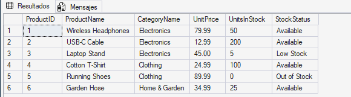
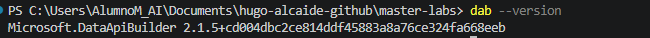
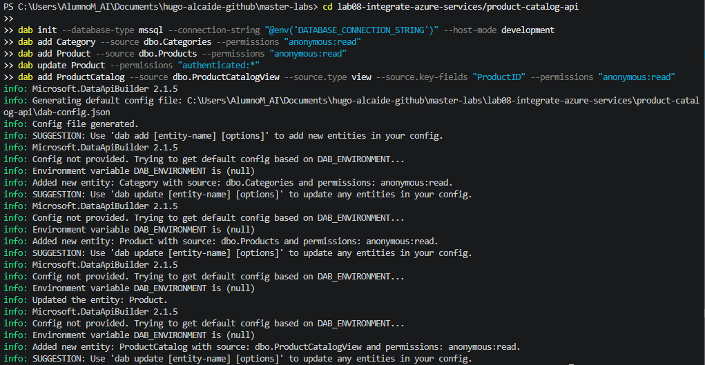
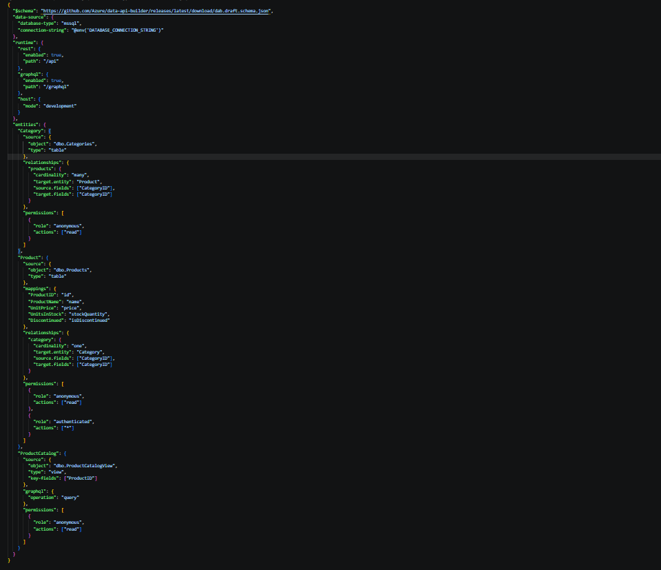
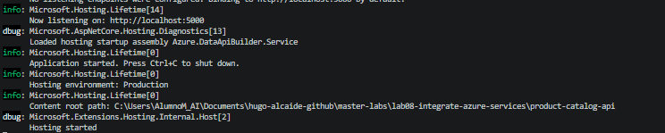
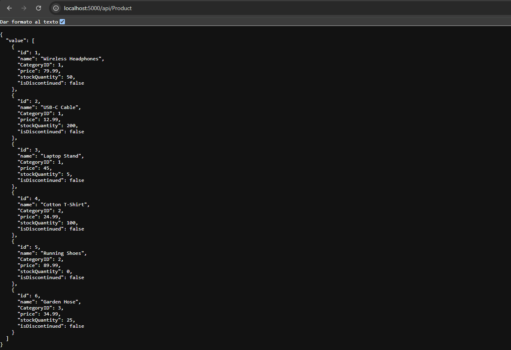
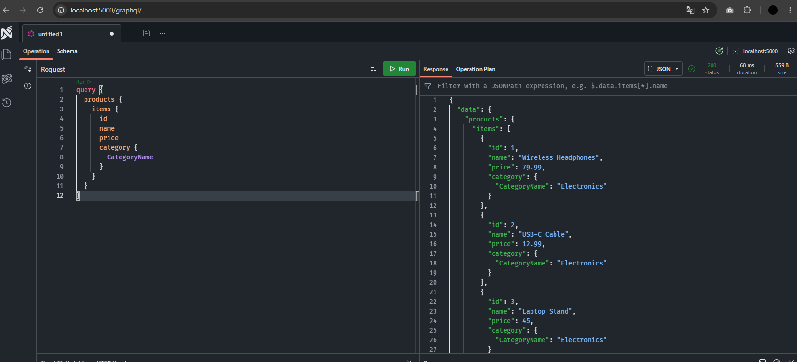

# Laboratorio 08: Integración de soluciones SQL con servicios de Azure (Data API Builder)

* **Autor:** Hugo Alcaide
* **Módulo:** Big Data
* **Ubicación:** `lab08-integrate-azure-services/`

---

### 1. Creación de la base de datos y objetos de catálogo
Creamos la base de datos `ProductCatalog` con las tablas `dbo.Categories` y `dbo.Products`, la vista `dbo.ProductCatalogView` (que cruza los productos activos con su categoría y calcula el estado del stock) e insertamos los datos de prueba.

```sql
CREATE DATABASE ProductCatalog;
GO

USE ProductCatalog;
GO

CREATE TABLE dbo.Categories (
    CategoryID INT IDENTITY(1,1) PRIMARY KEY,
    CategoryName NVARCHAR(50) NOT NULL,
    Description NVARCHAR(200)
);

CREATE TABLE dbo.Products (
    ProductID INT IDENTITY(1,1) PRIMARY KEY,
    ProductName NVARCHAR(100) NOT NULL,
    CategoryID INT NOT NULL,
    UnitPrice DECIMAL(10,2) NOT NULL,
    UnitsInStock INT NOT NULL DEFAULT 0,
    Discontinued BIT NOT NULL DEFAULT 0,
    CONSTRAINT FK_Products_Categories 
        FOREIGN KEY (CategoryID) REFERENCES dbo.Categories(CategoryID)
);
GO

CREATE VIEW dbo.ProductCatalogView AS
SELECT 
    p.ProductID,
    p.ProductName,
    c.CategoryName,
    p.UnitPrice,
    p.UnitsInStock,
    CASE 
        WHEN p.UnitsInStock = 0 THEN 'Out of Stock'
        WHEN p.UnitsInStock < 10 THEN 'Low Stock'
        ELSE 'Available'
    END AS StockStatus
FROM dbo.Products p
INNER JOIN dbo.Categories c ON p.CategoryID = c.CategoryID
WHERE p.Discontinued = 0;
GO

INSERT INTO dbo.Categories (CategoryName, Description) VALUES
('Electronics', 'Electronic devices and accessories'),
('Clothing', 'Apparel and fashion items'),
('Home & Garden', 'Products for home improvement');

INSERT INTO dbo.Products (ProductName, CategoryID, UnitPrice, UnitsInStock) VALUES
('Wireless Headphones', 1, 79.99, 50),
('USB-C Cable', 1, 12.99, 200),
('Laptop Stand', 1, 45.00, 5),
('Cotton T-Shirt', 2, 24.99, 100),
('Running Shoes', 2, 89.99, 0),
('Garden Hose', 3, 34.99, 25);
GO
```



---

### 2. Instalación de Data API Builder CLI
Instalamos de forma global la herramienta `Microsoft.DataApiBuilder` mediante el SDK de .NET y comprobamos la versión instalada.

```powershell
dotnet tool install --global Microsoft.DataApiBuilder
dab --version
```



---

### 3. Inicialización del proyecto y registro de entidades
Inicializamos el archivo `dab-config.json` referenciando la cadena de conexión por variable de entorno y añadimos las entidades para las tablas (`Category` y `Product`) y para la vista de solo lectura (`ProductCatalog` indicando `ProductID` como clave).

```powershell
dab init --database-type mssql --connection-string "@env('DATABASE_CONNECTION_STRING')" --host-mode development

dab add Category --source dbo.Categories --permissions "anonymous:read"
dab add Product --source dbo.Products --permissions "anonymous:read"
dab update Product --permissions "authenticated:*"
dab add ProductCatalog --source dbo.ProductCatalogView --source.type view --source.key-fields "ProductID" --permissions "anonymous:read"
```



---

### 4. Configuración de mapeos de campos y relaciones
Editamos `dab-config.json` para exponer nombres de campos más limpios en la entidad `Product` (`mappings`) y definimos la relación bidireccional `1:N` entre `Category` y `Product` (`relationships`) para permitir consultas anidadas en GraphQL.

```json
{
  "$schema": "[https://github.com/Azure/data-api-builder/releases/latest/download/dab.draft.schema.json](https://github.com/Azure/data-api-builder/releases/latest/download/dab.draft.schema.json)",
  "data-source": {
    "database-type": "mssql",
    "connection-string": "@env('DATABASE_CONNECTION_STRING')"
  },
  "runtime": {
    "rest": { "enabled": true, "path": "/api" },
    "graphql": { "enabled": true, "path": "/graphql" },
    "host": { "mode": "development" }
  },
  "entities": {
    "Category": {
      "source": { "object": "dbo.Categories", "type": "table" },
      "relationships": {
        "products": {
          "cardinality": "many",
          "target.entity": "Product",
          "source.fields": ["CategoryID"],
          "target.fields": ["CategoryID"]
        }
      },
      "permissions": [
        { "role": "anonymous", "actions": ["read"] }
      ]
    },
    "Product": {
      "source": { "object": "dbo.Products", "type": "table" },
      "mappings": {
        "ProductID": "id",
        "ProductName": "name",
        "UnitPrice": "price",
        "UnitsInStock": "stockQuantity",
        "Discontinued": "isDiscontinued"
      },
      "relationships": {
        "category": {
          "cardinality": "one",
          "target.entity": "Category",
          "source.fields": ["CategoryID"],
          "target.fields": ["CategoryID"]
        }
      },
      "permissions": [
        { "role": "anonymous", "actions": ["read"] },
        { "role": "authenticated", "actions": ["*"] }
      ]
    },
    "ProductCatalog": {
      "source": {
        "object": "dbo.ProductCatalogView",
        "type": "view",
        "key-fields": ["ProductID"]
      },
      "graphql": { "operation": "query" },
      "permissions": [
        { "role": "anonymous", "actions": ["read"] }
      ]
    }
  }
}
```



---

### 5. Ejecución local del servicio Data API Builder
Definimos la variable de entorno `DATABASE_CONNECTION_STRING` en la sesión de PowerShell autenticándonos contra la instancia local de SQL Server y levantamos el servidor con `dab start`.

```powershell
$env:DATABASE_CONNECTION_STRING="Server=localhost;Database=ProductCatalog;User Id=sa;Password=Telco0032;TrustServerCertificate=true"
dab start
```



---

### 6. Prueba del endpoint REST
Consultamos `http://localhost:5000/api/Product` desde el navegador, comprobando que devuelve los productos en formato JSON aplicando los alias configurados en la sección `mappings`.



---

### 7. Prueba del endpoint GraphQL con relaciones
Accedemos a `http://localhost:5000/graphql` y ejecutamos una consulta que navega desde cada producto hacia su categoría asociada a través de la relación definida.

```graphql
query {
  products {
    items {
      id
      name
      price
      category {
        CategoryName
      }
    }
  }
}
```

