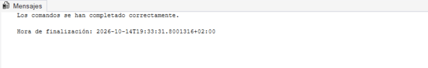
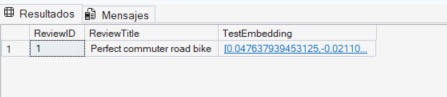
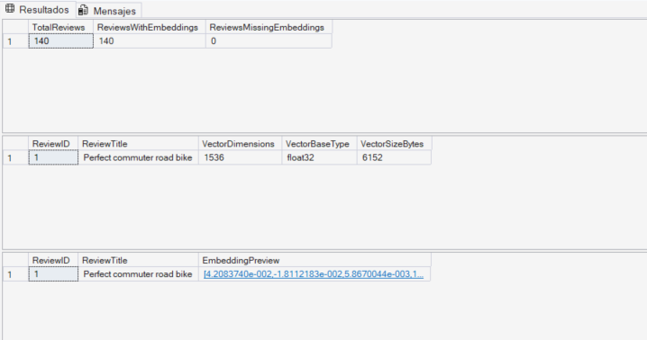
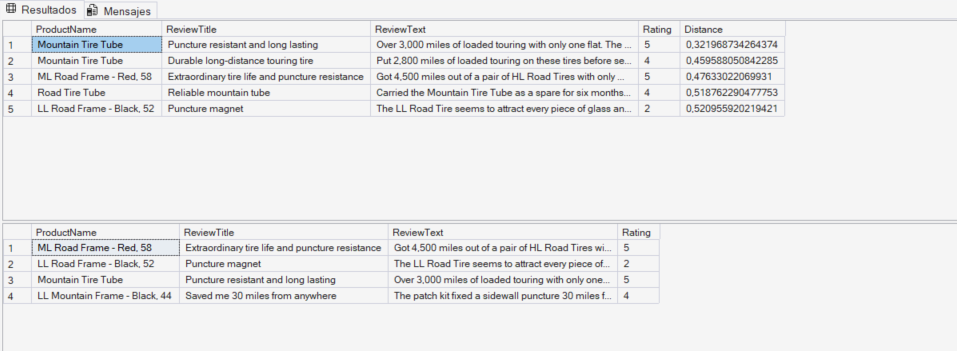
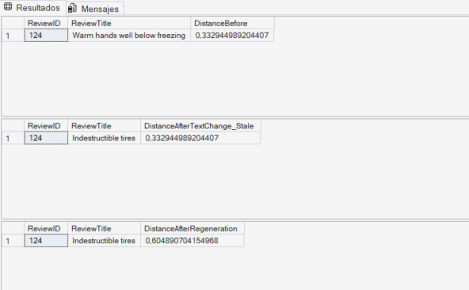
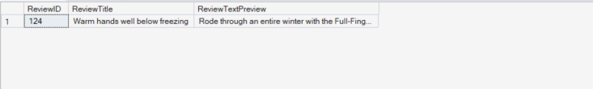

# Laboratorio 09: Generación y mantenimiento de embeddings en Azure SQL Database

* **Autor:** Hugo Alcaide
* **Módulo:** Big Data
* **Ubicación:** `lab09-generate-update-embeddings/`

---

### 1. Aprovisionamiento de Azure SQL Database e Identidad Administrada
Creamos la base de datos `AdventureWorksLT` con los datos de ejemplo (`Sample`) en el servidor lógico `sqlserver-alcaide` y activamos su identidad administrada asignada por el sistema (*System assigned managed identity* en `On`) para autenticarnos contra Azure OpenAI sin almacenar claves en el código.


---

### 2. Despliegue de modelos en Microsoft Foundry y permisos IAM
En nuestro recurso de Microsoft Foundry (`hugo-alcaide-4000-resource`) desplegamos el modelo de embeddings `text-embedding-3-small` junto con el modelo de chat `gpt-5-mini`, y desde **Access control (IAM)** asignamos el rol **Cognitive Services OpenAI User** a la identidad administrada de `sqlserver-alcaide`.


---

### 3. Creación y carga de la tabla `dbo.ProductReview`
Ejecutamos el script `product-reviews-insert.sql` sobre `AdventureWorksLT` para crear la tabla `dbo.ProductReview` y comprobamos que se han insertado las 140 reseñas de productos.

```sql
SELECT COUNT(*) AS TotalReviews FROM dbo.ProductReview;
GO
```


---

### 4. Creación de la credencial de base de datos y del modelo externo
Creamos la `MASTER KEY`, la credencial de base de datos apuntando a `https://hugo-alcaide-4000-resource.openai.azure.com` mediante `Managed Identity` y el modelo externo `my_embedding_model` vinculado al despliegue `text-embedding-3-small`.

```sql
IF NOT EXISTS (SELECT * FROM sys.symmetric_keys WHERE name = '##MS_DatabaseMasterKey##')
    CREATE MASTER KEY ENCRYPTION BY PASSWORD = 'StrongPassword123!@#';
GO

CREATE DATABASE SCOPED CREDENTIAL [[https://hugo-alcaide-4000-resource.openai.azure.com](https://hugo-alcaide-4000-resource.openai.azure.com)]
WITH IDENTITY = 'Managed Identity', SECRET = '{"resourceid":"[https://cognitiveservices.azure.com](https://cognitiveservices.azure.com)"}';
GO

CREATE EXTERNAL MODEL my_embedding_model
WITH (
    LOCATION = '[https://hugo-alcaide-4000-resource.openai.azure.com/openai/deployments/text-embedding-3-small/embeddings?api-version=2024-10-21](https://hugo-alcaide-4000-resource.openai.azure.com/openai/deployments/text-embedding-3-small/embeddings?api-version=2024-10-21)',
    API_FORMAT = 'Azure OpenAI',
    MODEL_TYPE = EMBEDDINGS,
    MODEL = 'text-embedding-3-small',
    CREDENTIAL = [[https://hugo-alcaide-4000-resource.openai.azure.com](https://hugo-alcaide-4000-resource.openai.azure.com)]
);
GO
```



---

### 5. Columna `VECTOR(1536)` y prueba de generación de embeddings
Añadimos la columna `ReviewVector` de tipo `VECTOR(1536)` a `dbo.ProductReview` y probamos `AI_GENERATE_EMBEDDINGS` con la primera reseña (`Perfect commuter road bike`) para verificar que devuelve el vector correctamente.

```sql
ALTER TABLE dbo.ProductReview
ADD ReviewVector VECTOR(1536);
GO

SELECT TOP 1
    r.ReviewID,
    r.ReviewTitle,
    AI_GENERATE_EMBEDDINGS(
        r.ReviewTitle + ': ' + r.ReviewText
        USE MODEL my_embedding_model
    ) AS TestEmbedding
FROM dbo.ProductReview r;
GO
```



---

### 6. Generación de embeddings por lotes e inspección con `VECTORPROPERTY`
Generamos los embeddings de las 140 reseñas en lotes de 30 filas combinando el nombre del producto, el título y el comentario. Después verificamos que las 140 filas tienen su vector completo y consultamos sus propiedades con `VECTORPROPERTY` (`1536` dimensiones, tipo base `float32` y `6152` bytes).

```sql
DECLARE @batchSize INT = 30;
DECLARE @rowsUpdated INT = 1;
DECLARE @retryCount INT;
DECLARE @maxRetries INT = 3;

WHILE @rowsUpdated > 0
BEGIN
    SET @retryCount = 0;

    RETRY:
    BEGIN TRY
        UPDATE TOP (@batchSize) r
        SET r.ReviewVector = AI_GENERATE_EMBEDDINGS(
            p.Name + ' - ' + r.ReviewTitle + ': ' + r.ReviewText
            USE MODEL my_embedding_model)
        FROM dbo.ProductReview r
        INNER JOIN SalesLT.Product p ON r.ProductID = p.ProductID
        WHERE r.ReviewVector IS NULL;

        SET @rowsUpdated = @@ROWCOUNT;

        IF @rowsUpdated > 0
            WAITFOR DELAY '00:00:02';
    END TRY
    BEGIN CATCH
        SET @retryCount += 1;
        IF @retryCount <= @maxRetries
        BEGIN
            WAITFOR DELAY '00:00:05';
            GOTO RETRY;
        END
        ELSE
            THROW;
    END CATCH
END
GO

-- Verificación de filas, dimensiones y vista previa
SELECT 
    COUNT(*) AS TotalReviews,
    COUNT(ReviewVector) AS ReviewsWithEmbeddings,
    COUNT(*) - COUNT(ReviewVector) AS ReviewsMissingEmbeddings
FROM dbo.ProductReview;

SELECT TOP 1
    r.ReviewID,
    r.ReviewTitle,
    VECTORPROPERTY(r.ReviewVector, 'Dimensions') AS VectorDimensions,
    VECTORPROPERTY(r.ReviewVector, 'BaseType') AS VectorBaseType,
    DATALENGTH(r.ReviewVector) AS VectorSizeBytes
FROM dbo.ProductReview r
WHERE r.ReviewVector IS NOT NULL;

SELECT TOP 1
    r.ReviewID,
    r.ReviewTitle,
    LEFT(CAST(r.ReviewVector AS NVARCHAR(MAX)), 200) AS EmbeddingPreview
FROM dbo.ProductReview r
WHERE r.ReviewVector IS NOT NULL;
GO
```



---

### 7. Búsqueda semántica con `VECTOR_DISTANCE` frente a búsqueda por palabras (`LIKE`)
Buscamos las 5 reseñas más parecidas a la pregunta `'Which tires last the longest and resist punctures?'` usando `VECTOR_DISTANCE('cosine', ...)` y lo comparamos con una búsqueda por texto con `LIKE '%puncture%'`. La búsqueda vectorial encuentra reseñas relevantes sobre durabilidad de neumáticos (como `Durable long-distance touring tire` o `Reliable mountain tube`) aunque no contengan la palabra literal *puncture*.

```sql
DECLARE @searchText NVARCHAR(1000) = 'Which tires last the longest and resist punctures?';
DECLARE @searchVector VECTOR(1536);

SELECT @searchVector = AI_GENERATE_EMBEDDINGS(@searchText USE MODEL my_embedding_model);

SELECT TOP 5
    p.Name AS ProductName,
    r.ReviewTitle,
    r.ReviewText,
    r.Rating,
    VECTOR_DISTANCE('cosine', @searchVector, r.ReviewVector) AS Distance
FROM dbo.ProductReview r
INNER JOIN SalesLT.Product p ON r.ProductID = p.ProductID
ORDER BY Distance;

SELECT TOP 5
    p.Name AS ProductName,
    r.ReviewTitle,
    r.ReviewText,
    r.Rating
FROM dbo.ProductReview r
INNER JOIN SalesLT.Product p ON r.ProductID = p.ProductID
WHERE r.ReviewText LIKE '%puncture%';
GO
```



---

### 8. Mantenimiento de embeddings ante cambios en el texto
Comprobamos la distancia de la reseña 124 frente a la consulta `'warm winter cycling gloves'` (`0,3329`). Al cambiar su texto por una reseña de neumáticos sin actualizar el vector, la distancia sigue siendo idéntica (`0,3329`) porque el vector ha quedado desactualizado (*stale*). Una vez regenerado el vector con `AI_GENERATE_EMBEDDINGS`, la distancia sube a `0,6048`, reflejando que el nuevo texto ya no trata sobre guantes.

```sql
DECLARE @searchVector VECTOR(1536);
SELECT @searchVector = AI_GENERATE_EMBEDDINGS('warm winter cycling gloves' USE MODEL my_embedding_model);

-- 1. Distancia ANTES del cambio
SELECT
    r.ReviewID,
    r.ReviewTitle,
    VECTOR_DISTANCE('cosine', @searchVector, r.ReviewVector) AS DistanceBefore
FROM dbo.ProductReview r
WHERE r.ReviewID = 124;

-- 2. Cambiamos el texto sin actualizar el vector
UPDATE dbo.ProductReview
SET ReviewText = 'These tires are the most puncture-resistant tires I have ever used. Over 3000 miles with zero flats on rough gravel roads.',
    ReviewTitle = N'Indestructible tires'
WHERE ReviewID = 124;

SELECT
    r.ReviewID,
    r.ReviewTitle,
    VECTOR_DISTANCE('cosine', @searchVector, r.ReviewVector) AS DistanceAfterTextChange_Stale
FROM dbo.ProductReview r
WHERE r.ReviewID = 124;

-- 3. Regeneramos el vector para el nuevo texto
UPDATE r
SET r.ReviewVector = AI_GENERATE_EMBEDDINGS(
    p.Name + ' - ' + r.ReviewTitle + ': ' + r.ReviewText
    USE MODEL my_embedding_model)
FROM dbo.ProductReview r
INNER JOIN SalesLT.Product p ON r.ProductID = p.ProductID
WHERE r.ReviewID = 124;

SELECT
    r.ReviewID,
    r.ReviewTitle,
    VECTOR_DISTANCE('cosine', @searchVector, r.ReviewVector) AS DistanceAfterRegeneration
FROM dbo.ProductReview r
WHERE r.ReviewID = 124;
GO
```



---

### 9. Restauración de los datos originales
Restauramos el título y texto original de la reseña 124 (`Warm hands well below freezing`) y regeneramos su embedding para dejar la tabla lista para los siguientes laboratorios.

```sql
UPDATE dbo.ProductReview
SET ReviewTitle = N'Warm hands well below freezing',
    ReviewText = N'Rode through an entire winter with the Full-Finger Gloves and never had cold fingers even at minus 5 degrees with wind chill. The fleece lining is cozy without being bulky and I can still operate my brake levers precisely. Essential cold weather gear.'
WHERE ReviewID = 124;
GO

UPDATE r
SET r.ReviewVector = AI_GENERATE_EMBEDDINGS(
    p.Name + ' - ' + r.ReviewTitle + ': ' + r.ReviewText
    USE MODEL my_embedding_model)
FROM dbo.ProductReview r
INNER JOIN SalesLT.Product p ON r.ProductID = p.ProductID
WHERE r.ReviewID = 124;
GO

SELECT ReviewID, ReviewTitle, LEFT(ReviewText, 80) AS ReviewTextPreview 
FROM dbo.ProductReview 
WHERE ReviewID = 124;
GO
```

