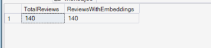
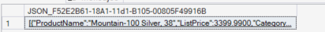
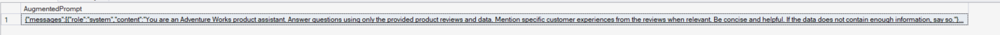
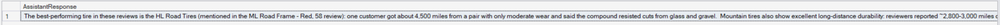
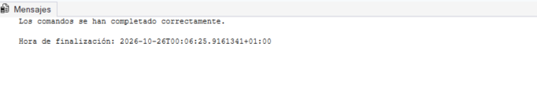
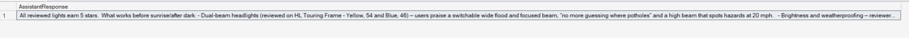
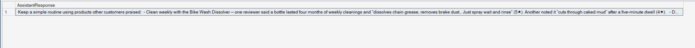
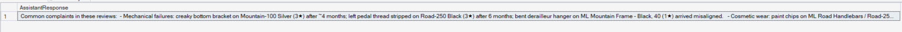

# Laboratorio 11: Implement RAG solutions in Azure SQL Database

En este laboratorio se construye un flujo completo **RAG (Retrieval-Augmented Generation)** íntegramente desde T-SQL en **Azure SQL Database**:
1. **Retrieval (Recuperación):** Conversión de la pregunta del usuario en un vector (`AI_GENERATE_EMBEDDINGS`) y búsqueda de las 5 reseñas más relevantes mediante `VECTOR_SEARCH` y el índice **DiskANN**, formateando la salida como contexto JSON (`FOR JSON PATH`).
2. **Augmentation (Aumento):** Construcción dinámica del payload JSON con instrucciones de sistema (*grounding*) y el contexto recuperado mediante `JSON_OBJECT` y `JSON_ARRAY`, adaptado a modelos con razonamiento (`max_completion_tokens`).
3. **Generation (Generación):** Invocación directa al endpoint REST de Azure OpenAI (`gpt-5-mini`) mediante `sp_invoke_external_rest_endpoint` y encapsulación en el procedimiento almacenado `dbo.AskProductQuestion`.

---

## Paso 1: Verificación de Reseñas, Embeddings e Índice DiskANN

Se comprueba que la tabla `dbo.ProductReview` cuenta con las 140 reseñas, los vectores generados en `ReviewVector VECTOR(1536)` y el índice `IX_Review_ReviewVector` activo:

```sql
SELECT 
    COUNT(*) AS TotalReviews,
    COUNT(ReviewVector) AS ReviewsWithEmbeddings
FROM dbo.ProductReview;
GO
```



---

## Paso 2: Recuperación de Contexto en Formato JSON (Retrieval)

Se vectoriza la pregunta del usuario y se recuperan las 5 reseñas semánticamente más cercanas utilizando `VECTOR_SEARCH` (sintaxis actualizada con `SELECT TOP (5)` y ordenación por distancia) y `FOR JSON PATH`:

```sql
DECLARE @userQuestion NVARCHAR(1000) = 'What mountain bike can handle really technical rocky trails?';
DECLARE @questionVector VECTOR(1536);

SELECT @questionVector = AI_GENERATE_EMBEDDINGS(@userQuestion USE MODEL my_embedding_model);

SELECT TOP (5)
    p.Name AS ProductName,
    p.ListPrice,
    pc.Name AS Category,
    r.Rating,
    r.ReviewTitle,
    r.ReviewText,
    vs.distance AS Distance
FROM VECTOR_SEARCH(
    TABLE = dbo.ProductReview AS r,
    COLUMN = ReviewVector,
    SIMILAR_TO = @questionVector,
    METRIC = 'cosine'
) AS vs
INNER JOIN SalesLT.Product p 
    ON r.ProductID = p.ProductID
INNER JOIN SalesLT.ProductCategory pc 
    ON p.ProductCategoryID = pc.ProductCategoryID
ORDER BY vs.distance ASC
FOR JSON PATH;
GO
```



---

## Paso 3: Construcción del Prompt Aumentado (Augmentation)

Se combina el contexto JSON recuperado de la base de datos con el prompt de sistema y la pregunta del usuario construyendo el payload mediante `JSON_OBJECT` y `JSON_ARRAY`, configurando `max_completion_tokens`:

```sql
DECLARE @userQuestion NVARCHAR(1000) = 'What is the best bike for commuting to work in rainy weather?';
DECLARE @questionVector VECTOR(1536);
DECLARE @context NVARCHAR(MAX);
DECLARE @payload NVARCHAR(MAX);

-- Step 1: Convert the question to an embedding
SELECT @questionVector = AI_GENERATE_EMBEDDINGS(@userQuestion USE MODEL my_embedding_model);

-- Step 2: Retrieve relevant reviews using ANN vector search
SET @context = (
    SELECT TOP (5)
        p.Name AS ProductName,
        p.ListPrice,
        pc.Name AS Category,
        r.Rating,
        r.ReviewTitle,
        r.ReviewText
    FROM VECTOR_SEARCH(
        TABLE = dbo.ProductReview AS r,
        COLUMN = ReviewVector,
        SIMILAR_TO = @questionVector,
        METRIC = 'cosine'
    ) AS vs
    INNER JOIN SalesLT.Product p 
        ON r.ProductID = p.ProductID
    INNER JOIN SalesLT.ProductCategory pc 
        ON p.ProductCategoryID = pc.ProductCategoryID
    ORDER BY vs.distance ASC
    FOR JSON PATH
);

-- Step 3: Build augmented prompt using JSON_OBJECT and JSON_ARRAY
SET @payload = JSON_OBJECT(
    'messages': JSON_ARRAY(
        JSON_OBJECT(
            'role': 'system', 
            'content': 'You are an Adventure Works product assistant. Answer questions using only the provided product reviews and data. Mention specific customer experiences from the reviews when relevant. Be concise and helpful. If the data does not contain enough information, say so.'
        ),
        JSON_OBJECT(
            'role': 'user', 
            'content': 'Product reviews: ' + ISNULL(@context, '[]') + CHAR(10) + CHAR(10) + 'Customer question: ' + @userQuestion
        )
    ),
    'max_completion_tokens': CAST(1500 AS INT)
);

SELECT @payload AS AugmentedPrompt;
GO
```



---

## Paso 4: Invocación a Azure OpenAI y Generación de Respuesta (Generation)

Se envía el payload al modelo desplegado (`gpt-5-mini`) mediante `sp_invoke_external_rest_endpoint` autenticando con la credencial `Managed Identity` y se extrae el contenido de `$.result.choices[0].message.content`:

```sql
DECLARE @userQuestion NVARCHAR(1000) = 'Which tires last the longest and resist punctures?';
DECLARE @questionVector VECTOR(1536);
DECLARE @context NVARCHAR(MAX);
DECLARE @payload NVARCHAR(MAX);
DECLARE @response NVARCHAR(MAX);
DECLARE @returnValue INT;

-- Step 1: Convert the question to an embedding
SELECT @questionVector = AI_GENERATE_EMBEDDINGS(@userQuestion USE MODEL my_embedding_model);

-- Step 2: Retrieve relevant reviews using ANN vector search
SET @context = (
    SELECT TOP (5)
        p.Name AS ProductName,
        p.ListPrice,
        pc.Name AS Category,
        r.Rating,
        r.ReviewTitle,
        r.ReviewText
    FROM VECTOR_SEARCH(
        TABLE = dbo.ProductReview AS r,
        COLUMN = ReviewVector,
        SIMILAR_TO = @questionVector,
        METRIC = 'cosine'
    ) AS vs
    INNER JOIN SalesLT.Product p 
        ON r.ProductID = p.ProductID
    INNER JOIN SalesLT.ProductCategory pc 
        ON p.ProductCategoryID = pc.ProductCategoryID
    ORDER BY vs.distance ASC
    FOR JSON PATH
);

-- Step 3: Build augmented prompt
SET @payload = JSON_OBJECT(
    'messages': JSON_ARRAY(
        JSON_OBJECT(
            'role': 'system', 
            'content': 'You are an Adventure Works product assistant. Answer questions using only the provided product reviews and data. Mention specific customer experiences from the reviews when relevant. Be concise and helpful. If the data does not contain enough information, say so.'
        ),
        JSON_OBJECT(
            'role': 'user', 
            'content': 'Product reviews: ' + ISNULL(@context, '[]') + CHAR(10) + CHAR(10) + 'Customer question: ' + @userQuestion
        )
    ),
    'max_completion_tokens': CAST(1500 AS INT)
);

-- Step 4: Call Azure OpenAI
EXECUTE @returnValue = sp_invoke_external_rest_endpoint
    @url = N'[https://proj-sqlailab-resource.openai.azure.com/openai/deployments/gpt-5-mini/chat/completions?api-version=2024-10-21](https://proj-sqlailab-resource.openai.azure.com/openai/deployments/gpt-5-mini/chat/completions?api-version=2024-10-21)',
    @method = 'POST',
    @payload = @payload,
    @credential = [[https://proj-sqlailab-resource.openai.azure.com](https://proj-sqlailab-resource.openai.azure.com)],
    @response = @response OUTPUT;

-- Step 5: Extract and display the answer
IF @returnValue = 0
BEGIN
    DECLARE @answer NVARCHAR(MAX);
    SET @answer = JSON_VALUE(@response, '$.result.choices[0].message.content');
    SELECT @answer AS AssistantResponse;
END
ELSE
BEGIN
    SELECT 
        @returnValue AS HttpStatus,
        JSON_VALUE(@response, '$.response.status.http.description') AS ErrorDescription;
END
GO
```



---

## Paso 5: Creación del Procedimiento Almacenado dbo.AskProductQuestion

Se encapsula toda la tubería RAG dentro de un procedimiento almacenado reutilizable con control de errores HTTP (`429`, `401`, `403`):

```sql
CREATE OR ALTER PROCEDURE dbo.AskProductQuestion
    @Question NVARCHAR(1000),
    @Answer NVARCHAR(MAX) OUTPUT
AS
BEGIN
    SET NOCOUNT ON;

    DECLARE @questionVector VECTOR(1536);
    DECLARE @context NVARCHAR(MAX);
    DECLARE @payload NVARCHAR(MAX);
    DECLARE @response NVARCHAR(MAX);
    DECLARE @returnValue INT;

    -- Step 1: Convert the question to an embedding
    SELECT @questionVector = AI_GENERATE_EMBEDDINGS(@Question USE MODEL my_embedding_model);

    -- Step 2: Retrieve relevant reviews using ANN vector search
    SET @context = (
        SELECT TOP (5)
            p.Name AS ProductName,
            p.ListPrice,
            pc.Name AS Category,
            r.Rating,
            r.ReviewTitle,
            r.ReviewText
        FROM VECTOR_SEARCH(
            TABLE = dbo.ProductReview AS r,
            COLUMN = ReviewVector,
            SIMILAR_TO = @questionVector,
            METRIC = 'cosine'
        ) AS vs
        INNER JOIN SalesLT.Product p 
            ON r.ProductID = p.ProductID
        INNER JOIN SalesLT.ProductCategory pc 
            ON p.ProductCategoryID = pc.ProductCategoryID
        ORDER BY vs.distance ASC
        FOR JSON PATH
    );

    -- Check if context was retrieved
    IF @context IS NULL
    BEGIN
        SET @Answer = 'No reviews found matching your query. Please try a different question.';
        RETURN;
    END

    -- Step 3: Build the augmented prompt
    SET @payload = JSON_OBJECT(
        'messages': JSON_ARRAY(
            JSON_OBJECT(
                'role': 'system', 
                'content': 'You are an Adventure Works product assistant. Follow these rules:
1. Answer only using the provided product reviews and data
2. Reference specific customer experiences from the reviews when relevant
3. Include star ratings to help the customer assess product quality
4. Keep responses under 150 words
5. Suggest related products when relevant'
            ),
            JSON_OBJECT(
                'role': 'user', 
                'content': 'Product reviews: ' + @context + CHAR(10) + CHAR(10) + 'Customer question: ' + @Question
            )
        ),
        'max_completion_tokens': CAST(1500 AS INT)
    );

    -- Step 4: Call the model
    EXECUTE @returnValue = sp_invoke_external_rest_endpoint
        @url = N'[https://proj-sqlailab-resource.openai.azure.com/openai/deployments/gpt-5-mini/chat/completions?api-version=2024-10-21](https://proj-sqlailab-resource.openai.azure.com/openai/deployments/gpt-5-mini/chat/completions?api-version=2024-10-21)',
        @method = 'POST',
        @payload = @payload,
        @credential = [[https://proj-sqlailab-resource.openai.azure.com](https://proj-sqlailab-resource.openai.azure.com)],
        @response = @response OUTPUT;

    -- Step 5: Extract the answer or handle errors
    IF @returnValue = 0
        SET @Answer = JSON_VALUE(@response, '$.result.choices[0].message.content');
    ELSE IF @returnValue = 429
        SET @Answer = 'The service is currently busy. Please try again in a moment.';
    ELSE IF @returnValue IN (401, 403)
        SET @Answer = 'Authentication failed. Please check the credential configuration.';
    ELSE
        SET @Answer = 'Unable to process your question at this time. HTTP status: ' + CAST(@returnValue AS NVARCHAR(10));
END;
GO
```



---

## Paso 6: Pruebas del Asistente RAG

### 6.1 Consulta sobre iluminación y conducción nocturna
```sql
DECLARE @response NVARCHAR(MAX);

EXEC dbo.AskProductQuestion
    @Question = 'I ride before sunrise and after dark. What lights actually work well?',
    @Answer = @response OUTPUT;

SELECT @response AS AssistantResponse;
GO
```


### 6.2 Consulta sobre mantenimiento de bicicletas
```sql
DECLARE @response NVARCHAR(MAX);

EXEC dbo.AskProductQuestion
    @Question = 'How do I keep my bike maintained between shop visits?',
    @Answer = @response OUTPUT;

SELECT @response AS AssistantResponse;
GO
```


### 6.3 Consulta sobre problemas y quejas frecuentes
```sql
DECLARE @response NVARCHAR(MAX);

EXEC dbo.AskProductQuestion
    @Question = 'What are the most common problems or complaints people have with their bikes?',
    @Answer = @response OUTPUT;

SELECT @response AS AssistantResponse;
GO
```
