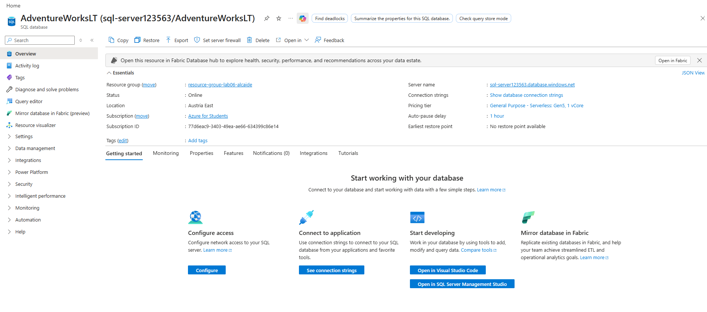
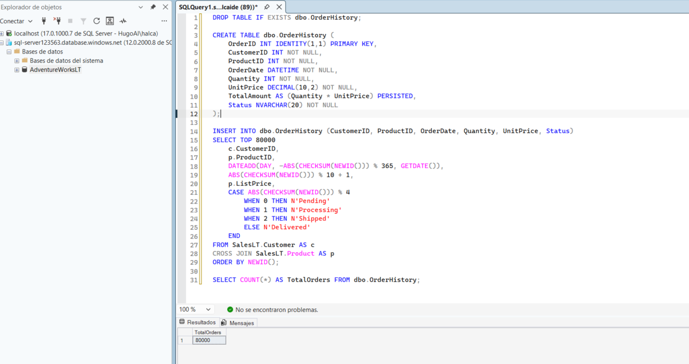
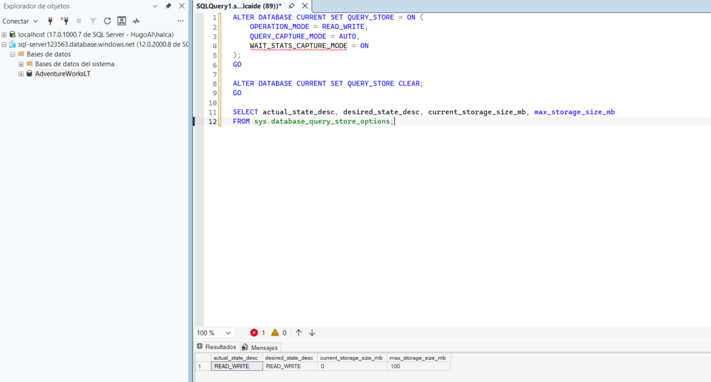
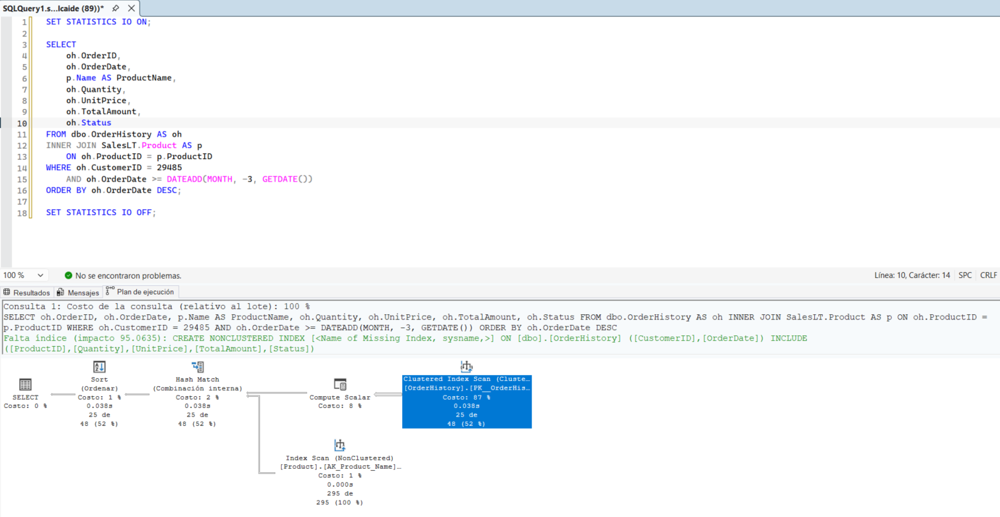
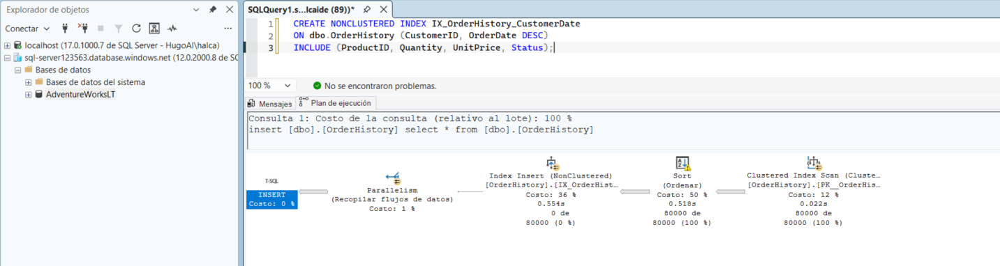
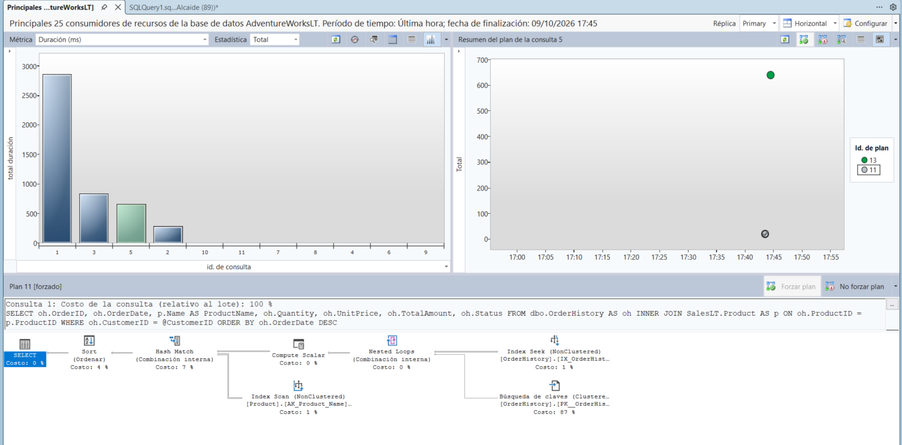
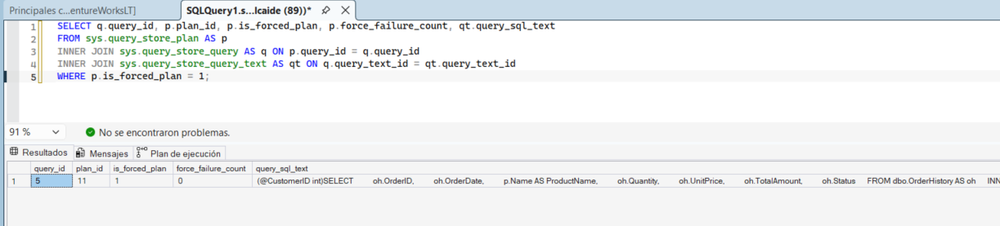
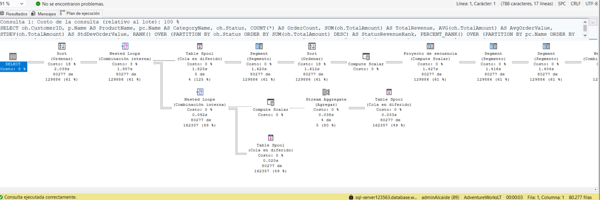
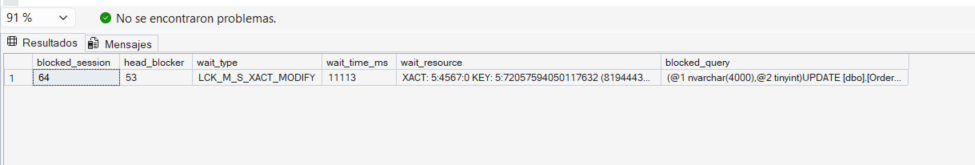
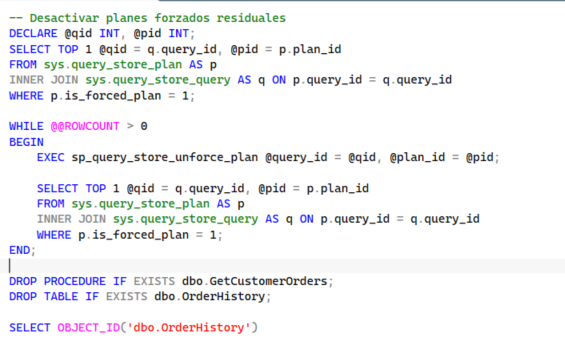

# Laboratorio 06: Optimización del Rendimiento de Bases de Datos en Azure SQL (Optimize Database Performance)

Este repositorio documenta la ejecución práctica del **Laboratorio 06**, centrado en el diagnóstico, análisis y resolución de problemas de rendimiento en **Azure SQL Database**. Se abordan técnicas de optimización de índices, telemetría con vistas de administración dinámica (*DMVs*), mitigación de regresiones de planes provocadas por *parameter sniffing* mediante *Query Store*, aplicación de directivas con *Query Store hints* y diagnóstico de contención por bloqueos (*blocking*).

---

## Índice de Contenidos

1. [Arquitectura y Entorno de Ejecución](#1-arquitectura-y-entorno-de-ejecución)
2. [Paso 1: Aprovisionamiento de Azure SQL Database](#paso-1-aprovisionamiento-de-azure-sql-database)
3. [Paso 2: Generación del Workload de Pruebas](#paso-2-generación-del-workload-de-pruebas)
4. [Paso 3: Configuración y Activación de Query Store](#paso-3-configuración-y-activación-de-query-store)
5. [Paso 4: Análisis de Execution Plans e Index Tuning](#paso-4-análisis-de-execution-plans-e-index-tuning)
6. [Paso 5: Diagnóstico Global de Consultas e Índices con DMVs](#paso-5-diagnóstico-global-de-consultas-e-índices-con-dmvs)
7. [Paso 6: Detección y Mitigación de Plan Regression con Query Store](#paso-6-detección-y-mitigación-de-plan-regression-con-query-store)
8. [Paso 7: Control de Paralelismo mediante Query Store Hints](#paso-7-control-de-paralelismo-mediante-query-store-hints)
9. [Paso 8: Diagnóstico y Resolución de Escenarios de Blocking](#paso-8-diagnóstico-y-resolución-de-escenarios-de-blocking)
10. [Paso 9: Limpieza del Entorno (Cleanup)](#paso-9-limpieza-del-entorno-cleanup)
11. [Conclusiones Técnicas](#conclusiones-técnicas)

---

## 1. Arquitectura y Entorno de Ejecución

* **Plataforma Cloud:** Microsoft Azure
* **Servicio:** Azure SQL Database
* **Modelo de Cómputo:** vCore - Serverless (General Purpose / Hyperscale)
* **Base de Datos Base:** `AdventureWorksLT` (Plantilla *Sample*)
* **Herramienta de Administración:** SQL Server Management Studio (SSMS 20+)
* **Mecanismos de Telemetría:** Dynamic Management Views (*DMVs*), Query Store, Actual Execution Plans

---

## Paso 1: Aprovisionamiento de Azure SQL Database

Se desplegó un servidor lógico de Azure SQL junto con la base de datos de ejemplo `AdventureWorksLT` configurada en un nivel de cómputo elástico (*Serverless*), permitiendo el escalado automático de vCores y pausa automática para optimización de costes.

* **Nombre del Servidor:** `sql-server123563.database.windows.net`
* **Base de Datos:** `AdventureWorksLT`
* **Región:** Austria East
* **Nivel de Servicio:** General Purpose - Serverless: Gen5, 1 vCore



---

## Paso 2: Generación del Workload de Pruebas

Dado que las tablas del esquema estándar de `AdventureWorksLT` contienen un volumen de datos reducido, se creó una tabla específica denominada `dbo.OrderHistory` poblada con **80.000 filas sintéticas** mediante un producto cartesiano (`CROSS JOIN`) entre clientes y productos existentes.

```sql
DROP TABLE IF EXISTS dbo.OrderHistory;

CREATE TABLE dbo.OrderHistory (
    OrderID INT IDENTITY(1,1) PRIMARY KEY,
    CustomerID INT NOT NULL,
    ProductID INT NOT NULL,
    OrderDate DATETIME NOT NULL,
    Quantity INT NOT NULL,
    UnitPrice DECIMAL(10,2) NOT NULL,
    TotalAmount AS (Quantity * UnitPrice) PERSISTED,
    Status NVARCHAR(20) NOT NULL
);

INSERT INTO dbo.OrderHistory (CustomerID, ProductID, OrderDate, Quantity, UnitPrice, Status)
SELECT TOP 80000
    c.CustomerID,
    p.ProductID,
    DATEADD(DAY, -ABS(CHECKSUM(NEWID())) % 365, GETDATE()),
    ABS(CHECKSUM(NEWID())) % 10 + 1,
    p.ListPrice,
    CASE ABS(CHECKSUM(NEWID())) % 4
        WHEN 0 THEN N'Pending'
        WHEN 1 THEN N'Processing'
        WHEN 2 THEN N'Shipped'
        ELSE N'Delivered'
    END
FROM SalesLT.Customer AS c
CROSS JOIN SalesLT.Product AS p
ORDER BY NEWID();

SELECT COUNT(*) AS TotalOrders FROM dbo.OrderHistory;
```

Se verificó la inserción íntegra de las 80.000 filas para asegurar que el optimizador genere planes de ejecución significativos.



---

## Paso 3: Configuración y Activación de Query Store

Se habilitó **Query Store** para persistir el historial de consultas compiladas, planes de ejecución y estadísticas de tiempo de ejecución directamente dentro del motor de base de datos. Se purgó cualquier métrica previa para aislar los experimentos del laboratorio.

```sql
ALTER DATABASE CURRENT SET QUERY_STORE = ON (
    OPERATION_MODE = READ_WRITE,
    QUERY_CAPTURE_MODE = AUTO,
    WAIT_STATS_CAPTURE_MODE = ON
);
GO

ALTER DATABASE CURRENT SET QUERY_STORE CLEAR;
GO

SELECT actual_state_desc, desired_state_desc, current_storage_size_mb, max_storage_size_mb
FROM sys.database_query_store_options;
```

El estado de Query Store confirmó `actual_state_desc = READ_WRITE`, garantizando la captura activa de telemetría.



---

## Paso 4: Análisis de Execution Plans e Index Tuning

### 4.1 Identificación del Plan Ineficiente y Missing Index
Se ejecutó una consulta de búsqueda de pedidos recientes para un cliente concreto (`CustomerID = 29485`) capturando el plan de ejecución real (*Actual Execution Plan*, `Ctrl + M`) y estadísticas de lectura de E/S (`STATISTICS IO`).

```sql
SET STATISTICS IO ON;

SELECT
    oh.OrderID,
    oh.OrderDate,
    p.Name AS ProductName,
    oh.Quantity,
    oh.UnitPrice,
    oh.TotalAmount,
    oh.Status
FROM dbo.OrderHistory AS oh
INNER JOIN SalesLT.Product AS p
    ON oh.ProductID = p.ProductID
WHERE oh.CustomerID = 29485
    AND oh.OrderDate >= DATEADD(MONTH, -3, GETDATE())
ORDER BY oh.OrderDate DESC;

SET STATISTICS IO OFF;
```

**Diagnóstico:** El motor tuvo que realizar un **Clustered Index Scan** sobre toda la tabla `OrderHistory` (asumiendo el 87% del coste total) al no existir una estructura ordenada para `CustomerID` y `OrderDate`. El optimizador emitió una advertencia de índice faltante (*Missing Index*) estimando una mejora de rendimiento del **95.06%**.



### 4.2 Creación del Covering Index
Se diseñó un índice no agrupado cubriente (*covering index*) con ordenación descendente en la clave `OrderDate` para evitar operadores de ordenación adicionales (`Sort`) y eliminando la necesidad de realizar búsquedas puntuales a la tabla base (*Key Lookups*).

```sql
CREATE NONCLUSTERED INDEX IX_OrderHistory_CustomerDate
ON dbo.OrderHistory (CustomerID, OrderDate DESC)
INCLUDE (ProductID, Quantity, UnitPrice, Status);
```



Tras la creación del índice, la consulta transformó su operador de acceso a un **Index Seek**, reduciendo sustancialmente las lecturas lógicas (*logical reads*) y el consumo de CPU.

---

## Paso 5: Diagnóstico Global de Consultas e Índices con DMVs

En lugar de evaluar consultas individuales, se emplearon vistas de administración dinámica para diagnosticar el impacto en toda la base de datos. Se ejecutó una consulta repetitiva de pedidos pendientes 5 veces (`GO 5`) para que el optimizador acumulara estadísticas de uso:

```sql
SELECT
    p.Name AS ProductName,
    p.ProductNumber,
    oh.OrderDate,
    oh.Quantity,
    oh.TotalAmount
FROM dbo.OrderHistory AS oh
INNER JOIN SalesLT.Product AS p
    ON oh.ProductID = p.ProductID
WHERE oh.Status = N'Pending'
    AND oh.OrderDate >= DATEADD(MONTH, -1, GETDATE())
ORDER BY oh.TotalAmount DESC;
GO 5
```

A continuación, se consultó el catálogo de *Missing Indexes* (`sys.dm_db_missing_index_*`):

```sql
SELECT TOP 10
    mid.statement AS table_name,
    mid.equality_columns,
    mid.inequality_columns,
    mid.included_columns,
    ROUND(migs.avg_total_user_cost * migs.avg_user_impact *
        (migs.user_seeks + migs.user_scans), 2) AS improvement_measure
FROM sys.dm_db_missing_index_groups AS mig
INNER JOIN sys.dm_db_missing_index_group_stats AS migs
    ON migs.group_handle = mig.index_group_handle
INNER JOIN sys.dm_db_missing_index_details mid
    ON mig.index_handle = mid.index_handle
ORDER BY improvement_measure DESC;
```

El resultado identificó de forma inequívoca la necesidad de crear un índice estructurado con igualdad en `[Status]`, desigualdad en `[OrderDate]` y columnas de cobertura en el `INCLUDE`.


---

## Paso 6: Detección y Mitigación de Plan Regression con Query Store

### 6.1 Simulación de Parameter Sniffing
Se sustituyó el índice cubriente por un índice no cubriente para reintroducir el dilema de coste entre *Index Seek + Key Lookup* y *Table Scan*. Se introdujo un sesgo severo en los datos asignando **50.000 pedidos al cliente 1**, mientras que los demás conservaban menos de 100 pedidos.

Se encapsuló la consulta en el procedimiento almacenado `dbo.GetCustomerOrders`:

1. Se ejecutó con `CustomerID = 29485` generando un plan rápido de **Index Seek** (Plan 11, ~20 ms).
2. Se limpió la caché y se ejecutó con `CustomerID = 1` obligando al motor a compilar un plan de **Clustered Index Scan** (Plan 13, ~650 ms).
3. Se volvió a consultar `CustomerID = 29485`, provocando que el procedimiento reutilizara erróneamente el plan de escaneo masivo (Plan Regression).

### 6.2 Detección y Forzado de Plan (Plan Forcing) en GUI
Desde el panel **Top Resource Consuming Queries** de Query Store en SSMS, se visualizaron ambos planes generados para la misma consulta. Se seleccionó el plan rápido (**Plan 11**) y se ejecutó la acción **Forzar plan**.



### 6.3 Verificación de Plan Forzado con T-SQL
Se confirmó la persistencia del plan forzado consultando las vistas del catálogo de Query Store:

```sql
SELECT
    q.query_id,
    p.plan_id,
    p.is_forced_plan,
    p.force_failure_count,
    qt.query_sql_text
FROM sys.query_store_plan AS p
INNER JOIN sys.query_store_query AS q
    ON p.query_id = q.query_id
INNER JOIN sys.query_store_query_text AS qt
    ON q.query_text_id = qt.query_text_id
WHERE p.is_forced_plan = 1;
```

La consulta confirmó `query_id = 5` con `plan_id = 11`, `is_forced_plan = 1` y `force_failure_count = 0`.



---

## Paso 7: Control de Paralelismo mediante Query Store Hints

Se ejecutó una consulta pesada de agregación dimensional con múltiples funciones de ventana (`RANK`, `PERCENT_RANK`) particionadas por diferentes columnas. El optimizador generó un plan paralelo utilizando operadores de intercambio de flujos (`Gather Streams`) e hilos concurrentes.

Para mitigar la contención de CPU en escenarios compartidos sin alterar el código de la aplicación, se inyectó una directiva a través de Query Store:

```sql
-- Obtención del query_id
SELECT q.query_id, qt.query_sql_text
FROM sys.query_store_query_text AS qt
INNER JOIN sys.query_store_query AS q ON qt.query_text_id = q.query_text_id
WHERE qt.query_sql_text LIKE '%RevenueRank%PARTITION%'
    AND qt.query_sql_text NOT LIKE '%query_store%';

-- Aplicación del hint
EXEC sp_query_store_set_hints
    @query_id = 26,
    @query_hints = N'OPTION (MAXDOP 1)';
```

Al volver a ejecutar la consulta con el plan de ejecución activo, se constató la desaparición total de las flechas amarillas de paralelismo y del operador *Gather Streams*, ejecutándose de manera puramente monohilo.



---

## Paso 8: Diagnóstico y Resolución de Escenarios de Blocking

Se simuló una contención transaccional entre dos operaciones de escritura concurrentes dirigidas sobre el mismo registro (`OrderID = 1`):

* **Sesión 1 (Bloqueadora - SPID 53):** Inició una transacción abierta modificando la fila (`UPDATE ... SET Status = 'Cancelled'`) sin emitir `COMMIT`.
* **Sesión 2 (Bloqueada - SPID 64):** Intentó modificar la misma fila (`UPDATE ... SET Status = 'Shipped'`), quedando suspendida indefinidamente.
* **Sesión 3 (Diagnóstico):** Se consultó `sys.dm_exec_requests` para mapear la cadena de contención:

```sql
SELECT
    r.session_id AS blocked_session,
    r.blocking_session_id AS head_blocker,
    r.wait_type,
    r.wait_time AS wait_time_ms,
    r.wait_resource,
    t.text AS blocked_query
FROM sys.dm_exec_requests AS r
CROSS APPLY sys.dm_exec_sql_text(r.sql_handle) AS t
WHERE r.blocking_session_id <> 0;
```

El resultado expuso que la sesión **64** estaba bloqueada por la sesión **53** (`head_blocker`) con un tipo de espera de bloqueo exclusivo (`LCK_M_S_XACT_MODIFY`).



El incidente se resolvió de forma inmediata ejecutando `ROLLBACK TRANSACTION;` en la sesión 53, permitiendo a la sesión 64 finalizar su transacción.

---

## Paso 9: Limpieza del Entorno (Cleanup)

Para restaurar la base de datos a su estado original y evitar consumo de recursos no deseado, se ejecutó un procedimiento automatizado que desvincula todos los planes forzados en Query Store y elimina los objetos creados para el laboratorio:

```sql
-- Desactivar planes forzados residuales
DECLARE @qid INT, @pid INT;
SELECT TOP 1 @qid = q.query_id, @pid = p.plan_id
FROM sys.query_store_plan AS p
INNER JOIN sys.query_store_query AS q ON p.query_id = q.query_id
WHERE p.is_forced_plan = 1;

WHILE @@ROWCOUNT > 0
BEGIN
    EXEC sp_query_store_unforce_plan @query_id = @qid, @plan_id = @pid;

    SELECT TOP 1 @qid = q.query_id, @pid = p.plan_id
    FROM sys.query_store_plan AS p
    INNER JOIN sys.query_store_query AS q ON p.query_id = q.query_id
    WHERE p.is_forced_plan = 1;
END;

DROP PROCEDURE IF EXISTS dbo.GetCustomerOrders;
DROP TABLE IF EXISTS dbo.OrderHistory;

SELECT OBJECT_ID('dbo.OrderHistory');
```



---

## Conclusiones Técnicas

1. **Covering Indexes:** La inclusión de columnas mediante la cláusula `INCLUDE` suprime el operador *Key Lookup*, mitigando cuellos de botella severos de E/S en tablas transaccionales de alto volumen.
2. **Mitigación de Parameter Sniffing:** La funcionalidad de *Plan Forcing* en Query Store ofrece una solución de estabilización inmediata ante regresiones imprevistas sin necesidad de redeployar código de aplicación.
3. **Control no invasivo con Query Store Hints:** La directiva `sp_query_store_set_hints` permite modular el grado de paralelismo (`MAXDOP`) de consultas complejas directamente en el motor de base de datos.
4. **Monitoreo con DMVs:** Las vistas dinámicas `sys.dm_exec_requests` y `sys.dm_db_missing_index_*` constituyen la primera línea de investigación para resolver escenarios de contención transaccional (*blocking*) y optimización proactiva de índices.