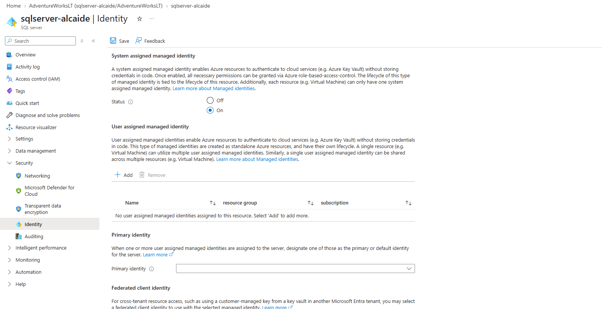
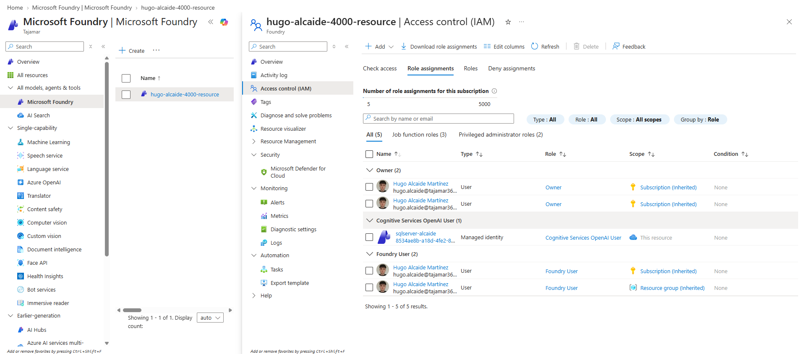
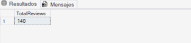

# Laboratorio 09: Generación y mantenimiento de embeddings en Azure SQL Database

* **Autor:** Hugo Alcaide
* **Módulo:** Big Data
* **Ubicación:** `lab09-generate-update-embeddings/`

---

### 1. Aprovisionamiento de Azure SQL Database e Identidad Administrada
Creamos la base de datos `AdventureWorksLT` con los datos de ejemplo (`Sample`) en el nivel Hyperscale Serverless y activamos la identidad administrada asignada por el sistema (*System assigned managed identity*) en el servidor lógico de SQL para que pueda autenticarse contra Azure OpenAI sin usar claves API en el código.



---

### 2. Despliegue de modelos en Microsoft Foundry y permisos IAM
Creamos el proyecto en Microsoft Foundry, desplegamos el modelo de embeddings `text-embedding-3-small` junto con el modelo de chat y asignamos el rol **Cognitive Services OpenAI User** a la identidad administrada de nuestro servidor SQL sobre el recurso de Azure OpenAI.



---

### 3. Creación y carga de la tabla `dbo.ProductReview`
Ejecutamos el script `product-reviews-insert.sql` sobre `AdventureWorksLT` para crear la tabla `dbo.ProductReview` y cargar las 140 reseñas de clientes de distintas categorías de productos.

```sql
SELECT COUNT(*) AS TotalReviews FROM dbo.ProductReview;
GO
```



---

### 4. Creación de la credencial de base de datos y del modelo externo
Creamos la `MASTER KEY`, la credencial de ámbito de base de datos usando `Managed Identity` contra el servicio de Cognitive Services y definimos el objeto `EXTERNAL MODEL` (`my_embedding_model`) apuntando al despliegue de `text-embedding-3-small`.

```sql
IF NOT EXISTS (SELECT * FROM sys.symmetric_keys WHERE name = '##MS_DatabaseMasterKey##')
    CREATE MASTER KEY ENCRYPTION BY PASSWORD = 'StrongPassword123!@#';
GO

CREATE DATABASE SCOPED CREDENTIAL [https://<tu-endpoint-openai>.openai.azure.com]
WITH IDENTITY = 'Managed Identity', SECRET = '{"resourceid":"[https://cognitiveservices.azure.com](https://cognitiveservices.azure.com)"}';
GO

CREATE EXTERNAL MODEL my_embedding_model
WITH (
    LOCATION = 'https://<tu-endpoint-openai>[.openai.azure.com/openai/deployments/text-embedding-3-small/embeddings?api-version=2024-10-21](https://.openai.azure.com/openai/deployments/text-embedding-3-small/embeddings?api-version=2024-10-21)',
    API_FORMAT = 'Azure OpenAI',
    MODEL_TYPE = EMBEDDINGS,
    MODEL = 'text-embedding-3-small',
    CREDENTIAL = [https://<tu-endpoint-openai>.openai.azure.com]
);
GO
```


---

### 5. Columna `VECTOR(1536)` y prueba de generación de embeddings
Añadimos la columna `ReviewVector` con el tipo nativo `VECTOR(1536)` a la tabla de reseñas y probamos la función `AI_GENERATE_EMBEDDINGS` sobre una primera fila para verificar la comunicación con Azure OpenAI.

```sql
ALTER TABLE dbo.ProductReview
ADD ReviewVector VECTOR(1536);
GO

SELECT TOP 1
    r.ReviewID,
    r.ReviewTitle,
    AI_GENERATE_EMBEDDINGS(
        r.ReviewTitle + ': ' + r.ReviewText
        USE MODEL my_embedding_model
    ) AS TestEmbedding
FROM dbo.ProductReview r;
GO
```


---

### 6. Generación de embeddings por lotes e inspección con `VECTORPROPERTY`
Generamos los vectores para las 140 reseñas en lotes de 30 filas combinando el nombre del producto, el título y el texto de la reseña. Al terminar, comprobamos con `VECTORPROPERTY` que todos los vectores tienen 1536 dimensiones en formato `float` (~6 KB por fila).

```sql
DECLARE @batchSize INT = 30;
DECLARE @rowsUpdated INT = 1;
DECLARE @retryCount INT;
DECLARE @maxRetries INT = 3;

WHILE @rowsUpdated > 0
BEGIN
    SET @retryCount = 0;

    RETRY:
    BEGIN TRY
        UPDATE TOP (@batchSize) r
        SET r.ReviewVector = AI_GENERATE_EMBEDDINGS(
            p.Name + ' - ' + r.ReviewTitle + ': ' + r.ReviewText
            USE MODEL my_embedding_model)
        FROM dbo.ProductReview r
        INNER JOIN SalesLT.Product p ON r.ProductID = p.ProductID
        WHERE r.ReviewVector IS NULL;

        SET @rowsUpdated = @@ROWCOUNT;

        IF @rowsUpdated > 0
            WAITFOR DELAY '00:00:02';
    END TRY
    BEGIN CATCH
        SET @retryCount += 1;
        IF @retryCount <= @maxRetries
        BEGIN
            WAITFOR DELAY '00:00:05';
            GOTO RETRY;
        END
        ELSE
            THROW;
    END CATCH
END
GO

-- Verificación de filas, dimensiones y vista previa
SELECT 
    COUNT(*) AS TotalReviews,
    COUNT(ReviewVector) AS ReviewsWithEmbeddings,
    COUNT(*) - COUNT(ReviewVector) AS ReviewsMissingEmbeddings
FROM dbo.ProductReview;

SELECT TOP 1
    r.ReviewID,
    r.ReviewTitle,
    VECTORPROPERTY(r.ReviewVector, 'Dimensions') AS VectorDimensions,
    VECTORPROPERTY(r.ReviewVector, 'BaseType') AS VectorBaseType,
    DATALENGTH(r.ReviewVector) AS VectorSizeBytes
FROM dbo.ProductReview r
WHERE r.ReviewVector IS NOT NULL;

SELECT TOP 1
    r.ReviewID,
    r.ReviewTitle,
    LEFT(CAST(r.ReviewVector AS NVARCHAR(MAX)), 200) AS EmbeddingPreview
FROM dbo.ProductReview r
WHERE r.ReviewVector IS NOT NULL;
GO
```


---

### 7. Búsqueda semántica con `VECTOR_DISTANCE` frente a búsqueda por palabras (`LIKE`)
Convertimos una pregunta en lenguaje natural en un vector y buscamos las 5 reseñas más cercanas mediante distancia del coseno (`VECTOR_DISTANCE`). Al compararlo con un `LIKE '%puncture%'`, comprobamos que la búsqueda vectorial localiza también reseñas que hablan de resistencia y durabilidad de neumáticos aunque no utilicen exactamente la palabra *puncture*.

```sql
DECLARE @searchText NVARCHAR(1000) = 'Which tires last the longest and resist punctures?';
DECLARE @searchVector VECTOR(1536);

SELECT @searchVector = AI_GENERATE_EMBEDDINGS(@searchText USE MODEL my_embedding_model);

SELECT TOP 5
    p.Name AS ProductName,
    r.ReviewTitle,
    r.ReviewText,
    r.Rating,
    VECTOR_DISTANCE('cosine', @searchVector, r.ReviewVector) AS Distance
FROM dbo.ProductReview r
INNER JOIN SalesLT.Product p ON r.ProductID = p.ProductID
ORDER BY Distance;

SELECT TOP 5
    p.Name AS ProductName,
    r.ReviewTitle,
    r.ReviewText,
    r.Rating
FROM dbo.ProductReview r
INNER JOIN SalesLT.Product p ON r.ProductID = p.ProductID
WHERE r.ReviewText LIKE '%puncture%';
GO
```


---

### 8. Mantenimiento de embeddings ante cambios en el texto
Comprobamos qué ocurre cuando se actualiza el texto de la reseña 124 (originalmente sobre guantes de invierno) para que hable de neumáticos sin regenerar su vector: la distancia frente a la búsqueda `'warm winter cycling gloves'` sigue siendo baja porque el vector ha quedado obsoleto (*stale*). Al recalcular `ReviewVector` con `AI_GENERATE_EMBEDDINGS`, la distancia aumenta reflejando el nuevo contenido.

```sql
DECLARE @searchVector VECTOR(1536);
SELECT @searchVector = AI_GENERATE_EMBEDDINGS('warm winter cycling gloves' USE MODEL my_embedding_model);

-- 1. Distancia inicial (guantes)
SELECT r.ReviewID, r.ReviewTitle, VECTOR_DISTANCE('cosine', @searchVector, r.ReviewVector) AS DistanceBefore
FROM dbo.ProductReview r WHERE r.ReviewID = 124;

-- 2. Cambio de texto sin actualizar el vector (embedding desactualizado)
UPDATE dbo.ProductReview
SET ReviewText = 'These tires are the most puncture-resistant tires I have ever used. Over 3000 miles with zero flats on rough gravel roads.',
    ReviewTitle = N'Indestructible tires'
WHERE ReviewID = 124;

SELECT r.ReviewID, r.ReviewTitle, VECTOR_DISTANCE('cosine', @searchVector, r.ReviewVector) AS DistanceAfterTextChange
FROM dbo.ProductReview r WHERE r.ReviewID = 124;

-- 3. Regeneración del vector y nueva distancia
UPDATE r
SET r.ReviewVector = AI_GENERATE_EMBEDDINGS(
    p.Name + ' - ' + r.ReviewTitle + ': ' + r.ReviewText
    USE MODEL my_embedding_model)
FROM dbo.ProductReview r
INNER JOIN SalesLT.Product p ON r.ProductID = p.ProductID
WHERE r.ReviewID = 124;

SELECT r.ReviewID, r.ReviewTitle, VECTOR_DISTANCE('cosine', @searchVector, r.ReviewVector) AS DistanceAfterRegeneration
FROM dbo.ProductReview r WHERE r.ReviewID = 124;
GO
```


---

### 9. Restauración de los datos originales
Restauramos el título, el texto y el embedding original de la reseña 124 para mantener la base de datos consistente de cara a los siguientes laboratorios.

```sql
UPDATE dbo.ProductReview
SET ReviewTitle = N'Warm hands well below freezing',
    ReviewText = N'Rode through an entire winter with the Full-Finger Gloves and never had cold fingers even at minus 5 degrees with wind chill. The fleece lining is cozy without being bulky and I can still operate my brake levers precisely. Essential cold weather gear.'
WHERE ReviewID = 124;
GO

UPDATE r
SET r.ReviewVector = AI_GENERATE_EMBEDDINGS(
    p.Name + ' - ' + r.ReviewTitle + ': ' + r.ReviewText
    USE MODEL my_embedding_model)
FROM dbo.ProductReview r
INNER JOIN SalesLT.Product p ON r.ProductID = p.ProductID
WHERE r.ReviewID = 124;
GO
```

