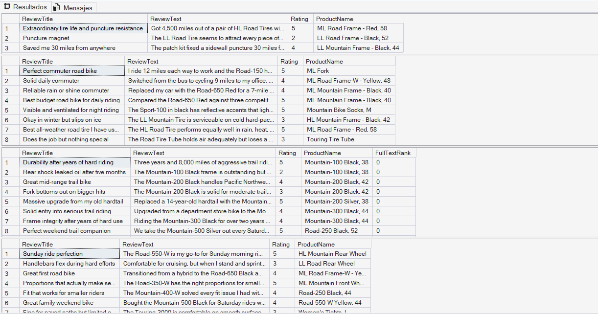
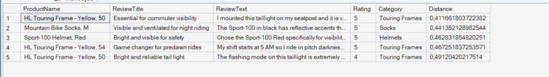
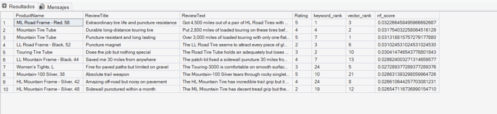
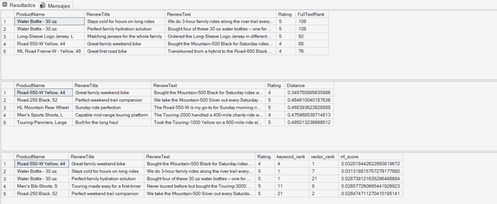

# Laboratorio 10: Implement intelligent search with full-text, vector, and hybrid queries

En este laboratorio se implementan y comparan tres enfoques de búsqueda inteligente en **Azure SQL Database** sobre la tabla `dbo.ProductReview` (140 reseñas de productos de AdventureWorksLT):
1. **Full-Text Search:** Búsqueda léxica mediante catálogos e índices de texto completo (`CONTAINS`, `FREETEXT`, `CONTAINSTABLE`, `FREETEXTTABLE`).
2. **Vector Search:** Búsqueda de similitud semántica exacta (`VECTOR_DISTANCE`) y aproximada (`VECTOR_SEARCH` con índice **DiskANN**) utilizando embeddings de 1536 dimensiones (`text-embedding-3-small`).
3. **Hybrid Search (RRF):** Combinación de búsqueda léxica (BM25) y semántica (ANN) mediante **Reciprocal Rank Fusion (RRF)**.

---

## Arquitectura y Requisitos Previos

* **Base de datos:** Azure SQL Database (`AdventureWorksLT`, nivel Hyperscale Serverless).
* **Modelos en Microsoft Foundry:** `text-embedding-3-small` y `gpt-5.4-mini`.
* **Seguridad:** Identidad administrada asignada por el sistema (System-assigned Managed Identity) con el rol *Cognitive Services OpenAI User*.

---

## Paso 1: Creación de la tabla ProductReview

Se ejecuta el script `product-reviews-insert.sql` y se verifica la carga de las 140 reseñas:

```sql
SELECT COUNT(*) AS TotalReviews FROM dbo.ProductReview;
GO
```


---

## Paso 2: Credencial de base de datos y Modelo Externo (EXTERNAL MODEL)

Se configura la clave maestra, la credencial basada en `Managed Identity` y el objeto `EXTERNAL MODEL` apuntando al despliegue de `text-embedding-3-small`:

```sql
-- Create a database master key if one doesn't exist
IF NOT EXISTS (SELECT * FROM sys.symmetric_keys WHERE name = '##MS_DatabaseMasterKey##')
    CREATE MASTER KEY ENCRYPTION BY PASSWORD = '<your strong password here>';
GO

-- Create a credential using Managed Identity
CREATE DATABASE SCOPED CREDENTIAL [https://<your-openai-endpoint>.openai.azure.com]
WITH IDENTITY = 'Managed Identity', SECRET = '{"resourceid":"[https://cognitiveservices.azure.com](https://cognitiveservices.azure.com)"}';
GO

-- Create an external model reference for embeddings
CREATE EXTERNAL MODEL my_embedding_model
WITH (
    LOCATION = 'https://<your-openai-endpoint>[.openai.azure.com/openai/deployments/text-embedding-3-small/embeddings?api-version=2024-10-21](https://.openai.azure.com/openai/deployments/text-embedding-3-small/embeddings?api-version=2024-10-21)',
    API_FORMAT = 'Azure OpenAI',
    MODEL_TYPE = EMBEDDINGS,
    MODEL = 'text-embedding-3-small',
    CREDENTIAL = [https://<your-openai-endpoint>.openai.azure.com]
);
GO
```


---

## Paso 3: Columna vectorial, generación de Embeddings e índice DiskANN

Se añade la columna `ReviewVector VECTOR(1536)`, se generan los embeddings en lotes de 30 registros controlando límites de tasa y se crea el índice vectorial **DiskANN**:

```sql
ALTER TABLE dbo.ProductReview
ADD ReviewVector VECTOR(1536);
GO

-- Generate embeddings in batches to avoid API rate limits
DECLARE @batchSize INT = 30;
DECLARE @rowsUpdated INT = 1;
DECLARE @retryCount INT;
DECLARE @maxRetries INT = 3;

WHILE @rowsUpdated > 0
BEGIN
    SET @retryCount = 0;

    RETRY:
    BEGIN TRY
        UPDATE TOP (@batchSize) r
        SET r.ReviewVector = AI_GENERATE_EMBEDDINGS(
            p.Name + ' - ' + r.ReviewTitle + ': ' + r.ReviewText
            USE MODEL my_embedding_model)
        FROM dbo.ProductReview r
        INNER JOIN SalesLT.Product p ON r.ProductID = p.ProductID
        WHERE r.ReviewVector IS NULL;

        SET @rowsUpdated = @@ROWCOUNT;

        IF @rowsUpdated > 0
            WAITFOR DELAY '00:00:02';
    END TRY
    BEGIN CATCH
        SET @retryCount += 1;
        IF @retryCount <= @maxRetries
        BEGIN
            PRINT 'Rate limited. Retrying in 5 seconds... (Attempt ' 
                + CAST(@retryCount AS NVARCHAR(10)) + ' of ' 
                + CAST(@maxRetries AS NVARCHAR(10)) + ')';
            WAITFOR DELAY '00:00:05';
            GOTO RETRY;
        END
        ELSE
            THROW;
    END CATCH
END
GO

-- Check how many reviews have embeddings
SELECT 
    COUNT(*) AS TotalReviews,
    COUNT(ReviewVector) AS ReviewsWithEmbeddings
FROM dbo.ProductReview;
GO

-- Enable preview features and create DiskANN vector index
ALTER DATABASE SCOPED CONFIGURATION SET PREVIEW_FEATURES = ON;
GO
ALTER DATABASE SCOPED CONFIGURATION SET ALLOW_STALE_VECTOR_INDEX = ON;
GO

CREATE VECTOR INDEX IX_Review_ReviewVector
ON dbo.ProductReview(ReviewVector)
WITH (METRIC = 'cosine', TYPE = 'DISKANN');
GO
```


---

## Paso 4: Creación del Catálogo e Índice Full-Text

Se crea el catálogo por defecto y el índice de texto completo sobre `ReviewTitle` y `ReviewText` con seguimiento de cambios automático:

```sql
CREATE FULLTEXT CATALOG ProductReviewCatalog AS DEFAULT;
GO

CREATE FULLTEXT INDEX ON dbo.ProductReview
(
    ReviewTitle LANGUAGE 1033,
    ReviewText LANGUAGE 1033
)
KEY INDEX PK_ProductReview
ON ProductReviewCatalog
WITH (CHANGE_TRACKING AUTO);
GO

-- Check full-text index status
SELECT 
    OBJECTPROPERTY(OBJECT_ID('dbo.ProductReview'), 'TableFullTextPopulateStatus') AS PopulateStatus,
    OBJECTPROPERTY(OBJECT_ID('dbo.ProductReview'), 'TableHasActiveFulltextIndex') AS HasActiveIndex;
GO
```


---

## Paso 5: Búsqueda con Predicados Full-Text

Pruebas de coincidencia exacta (`CONTAINS`), formas inflexivas (`FREETEXT`), ranking de relevancia (`CONTAINSTABLE`) y búsqueda por prefijos (`"comfort*"`):

```sql
-- 1. Exact word match with CONTAINS
SELECT 
    r.ReviewTitle,
    r.ReviewText,
    r.Rating,
    p.Name AS ProductName
FROM dbo.ProductReview r
INNER JOIN SalesLT.Product p ON r.ProductID = p.ProductID
WHERE CONTAINS(r.ReviewText, 'puncture');
GO

-- 2. Inflectional phrase search with FREETEXT
SELECT TOP 10
    r.ReviewTitle,
    r.ReviewText,
    r.Rating,
    p.Name AS ProductName
FROM dbo.ProductReview r
INNER JOIN SalesLT.Product p ON r.ProductID = p.ProductID
WHERE FREETEXT(r.ReviewText, 'warm gloves for cold winter commuting');
GO

-- 3. Ranked results with CONTAINSTABLE and FORMSOF
SELECT TOP 10
    r.ReviewTitle,
    r.ReviewText,
    r.Rating,
    p.Name AS ProductName,
    ft.[RANK] AS FullTextRank
FROM dbo.ProductReview r
INNER JOIN SalesLT.Product p ON r.ProductID = p.ProductID
INNER JOIN CONTAINSTABLE(dbo.ProductReview, (ReviewTitle, ReviewText), 
    'FORMSOF(INFLECTIONAL, mountain) AND FORMSOF(INFLECTIONAL, trail)') AS ft
    ON r.ReviewID = ft.[KEY]
ORDER BY ft.[RANK] DESC;
GO

-- 4. Prefix search
SELECT 
    r.ReviewTitle,
    r.ReviewText,
    r.Rating,
    p.Name AS ProductName
FROM dbo.ProductReview r
INNER JOIN SalesLT.Product p ON r.ProductID = p.ProductID
WHERE CONTAINS(r.ReviewText, '"comfort*"');
GO
```



---

## Paso 6: Búsqueda por Similitud Vectorial (VECTOR_DISTANCE y VECTOR_SEARCH)

Comparación entre búsqueda exacta KNN (`VECTOR_DISTANCE`) y búsqueda aproximada ANN sobre el grafo DiskANN (`VECTOR_SEARCH`), además de inspección de metadatos con `VECTORPROPERTY`:

```sql
-- 1. Exact Nearest Neighbor (KNN) with VECTOR_DISTANCE
DECLARE @searchText NVARCHAR(1000) = 'comfortable seat for long distance touring';
DECLARE @searchVector VECTOR(1536);

SELECT @searchVector = AI_GENERATE_EMBEDDINGS(@searchText USE MODEL my_embedding_model);

SELECT TOP 5
    p.Name AS ProductName,
    r.ReviewTitle,
    r.ReviewText,
    r.Rating,
    VECTOR_DISTANCE('cosine', @searchVector, r.ReviewVector) AS Distance
FROM dbo.ProductReview r
INNER JOIN SalesLT.Product p ON r.ProductID = p.ProductID
ORDER BY Distance;
GO

-- 2. Approximate Nearest Neighbor (ANN) with VECTOR_SEARCH
DECLARE @searchText NVARCHAR(1000) = 'something to keep me visible when riding at night';
DECLARE @searchVector VECTOR(1536);

SELECT @searchVector = AI_GENERATE_EMBEDDINGS(@searchText USE MODEL my_embedding_model);

SELECT
    p.Name AS ProductName,
    r.ReviewTitle,
    r.ReviewText,
    r.Rating,
    pc.Name AS Category,
    vs.distance AS Distance
FROM VECTOR_SEARCH(
    TABLE = dbo.ProductReview AS r,
    COLUMN = ReviewVector,
    SIMILAR_TO = @searchVector,
    METRIC = 'cosine',
    TOP_N = 5
) AS vs
INNER JOIN SalesLT.Product p 
    ON r.ProductID = p.ProductID
INNER JOIN SalesLT.ProductCategory pc 
    ON p.ProductCategoryID = pc.ProductCategoryID
ORDER BY vs.distance;
GO

-- 3. Inspect vector metadata
SELECT TOP 1
    VECTORPROPERTY(ReviewVector, 'Dimensions') AS VectorDimensions,
    VECTORPROPERTY(ReviewVector, 'BaseType') AS VectorBaseType
FROM dbo.ProductReview
WHERE ReviewVector IS NOT NULL;
GO
```



---

## Paso 7: Búsqueda Híbrida con Reciprocal Rank Fusion (RRF)

Fusión de rankings léxicos (`FREETEXTTABLE`) y vectoriales (`VECTOR_SEARCH`) mediante la fórmula RRF_Score = 1/(k + rank_keyword) + 1/(k + rank_vector) con k = 60:

```sql
DECLARE @searchText NVARCHAR(1000) = 'durable tires that resist punctures on rough terrain';
DECLARE @searchVector VECTOR(1536);
DECLARE @topN INT = 50;
DECLARE @rrfK INT = 60;

SELECT @searchVector = AI_GENERATE_EMBEDDINGS(@searchText USE MODEL my_embedding_model);

WITH keyword_search AS (
    SELECT TOP(@topN)
        r.ReviewID,
        RANK() OVER (ORDER BY ft.[RANK] DESC) AS keyword_rank
    FROM dbo.ProductReview r
    INNER JOIN FREETEXTTABLE(dbo.ProductReview, (ReviewTitle, ReviewText), @searchText) AS ft
        ON r.ReviewID = ft.[KEY]
),
vector_search AS (
    SELECT TOP(@topN)
        ReviewID,
        RANK() OVER (ORDER BY distance) AS vector_rank
    FROM (
        SELECT 
            r.ReviewID,
            vs.distance
        FROM VECTOR_SEARCH(
            TABLE = dbo.ProductReview AS r,
            COLUMN = ReviewVector,
            SIMILAR_TO = @searchVector,
            METRIC = 'cosine',
            TOP_N = 50
        ) AS vs
    ) AS similar_reviews
),
combined AS (
    SELECT
        COALESCE(ks.ReviewID, vs.ReviewID) AS ReviewID,
        ks.keyword_rank,
        vs.vector_rank,
        COALESCE(1.0 / (@rrfK + ks.keyword_rank), 0.0) +
        COALESCE(1.0 / (@rrfK + vs.vector_rank), 0.0) AS rrf_score
    FROM keyword_search ks
    FULL OUTER JOIN vector_search vs ON ks.ReviewID = vs.ReviewID
)
SELECT TOP 10
    p.Name AS ProductName,
    r.ReviewTitle,
    r.ReviewText,
    r.Rating,
    c.keyword_rank,
    c.vector_rank,
    c.rrf_score
FROM combined c
INNER JOIN dbo.ProductReview r ON c.ReviewID = r.ReviewID
INNER JOIN SalesLT.Product p ON r.ProductID = p.ProductID
ORDER BY c.rrf_score DESC;
GO
```



---

## Paso 8: Comparativa de los Tres Enfoques

Evaluación de la consulta `'comfortable bike for long weekend rides with the family'` bajo los tres métodos para contrastar resultados léxicos, semánticos e híbridos:

```sql
-- 1. Full-text search only
SELECT TOP 5
    p.Name AS ProductName,
    r.ReviewTitle,
    r.ReviewText,
    r.Rating,
    ft.[RANK] AS FullTextRank
FROM dbo.ProductReview r
INNER JOIN SalesLT.Product p ON r.ProductID = p.ProductID
INNER JOIN FREETEXTTABLE(dbo.ProductReview, (ReviewTitle, ReviewText), 
    'comfortable bike for long weekend rides with the family') AS ft
    ON r.ReviewID = ft.[KEY]
ORDER BY ft.[RANK] DESC;
GO

-- 2. Vector search only
DECLARE @searchText NVARCHAR(1000) = 'comfortable bike for long weekend rides with the family';
DECLARE @searchVector VECTOR(1536);

SELECT @searchVector = AI_GENERATE_EMBEDDINGS(@searchText USE MODEL my_embedding_model);

SELECT
    p.Name AS ProductName,
    r.ReviewTitle,
    r.ReviewText,
    r.Rating,
    vs.distance AS Distance
FROM VECTOR_SEARCH(
    TABLE = dbo.ProductReview AS r,
    COLUMN = ReviewVector,
    SIMILAR_TO = @searchVector,
    METRIC = 'cosine',
    TOP_N = 5
) AS vs
INNER JOIN SalesLT.Product p 
    ON r.ProductID = p.ProductID
ORDER BY vs.distance;
GO

-- 3. Hybrid search with RRF
DECLARE @searchText NVARCHAR(1000) = 'comfortable bike for long weekend rides with the family';
DECLARE @searchVector VECTOR(1536);
DECLARE @topN INT = 50;
DECLARE @rrfK INT = 60;

SELECT @searchVector = AI_GENERATE_EMBEDDINGS(@searchText USE MODEL my_embedding_model);

WITH keyword_search AS (
    SELECT TOP(@topN)
        r.ReviewID,
        RANK() OVER (ORDER BY ft.[RANK] DESC) AS keyword_rank
    FROM dbo.ProductReview r
    INNER JOIN FREETEXTTABLE(dbo.ProductReview, (ReviewTitle, ReviewText), @searchText) AS ft
        ON r.ReviewID = ft.[KEY]
),
vector_search AS (
    SELECT TOP(@topN)
        ReviewID,
        RANK() OVER (ORDER BY distance) AS vector_rank
    FROM (
        SELECT 
            r.ReviewID,
            vs.distance
        FROM VECTOR_SEARCH(
            TABLE = dbo.ProductReview AS r,
            COLUMN = ReviewVector,
            SIMILAR_TO = @searchVector,
            METRIC = 'cosine',
            TOP_N = 50
        ) AS vs
    ) AS similar_reviews
),
combined AS (
    SELECT
        COALESCE(ks.ReviewID, vs.ReviewID) AS ReviewID,
        ks.keyword_rank,
        vs.vector_rank,
        COALESCE(1.0 / (@rrfK + ks.keyword_rank), 0.0) +
        COALESCE(1.0 / (@rrfK + vs.vector_rank), 0.0) AS rrf_score
    FROM keyword_search ks
    FULL OUTER JOIN vector_search vs ON ks.ReviewID = vs.ReviewID
)
SELECT TOP 5
    p.Name AS ProductName,
    r.ReviewTitle,
    r.ReviewText,
    r.Rating,
    c.keyword_rank,
    c.vector_rank,
    c.rrf_score
FROM combined c
INNER JOIN dbo.ProductReview r ON c.ReviewID = r.ReviewID
INNER JOIN SalesLT.Product p ON r.ProductID = p.ProductID
ORDER BY c.rrf_score DESC;
GO
```

